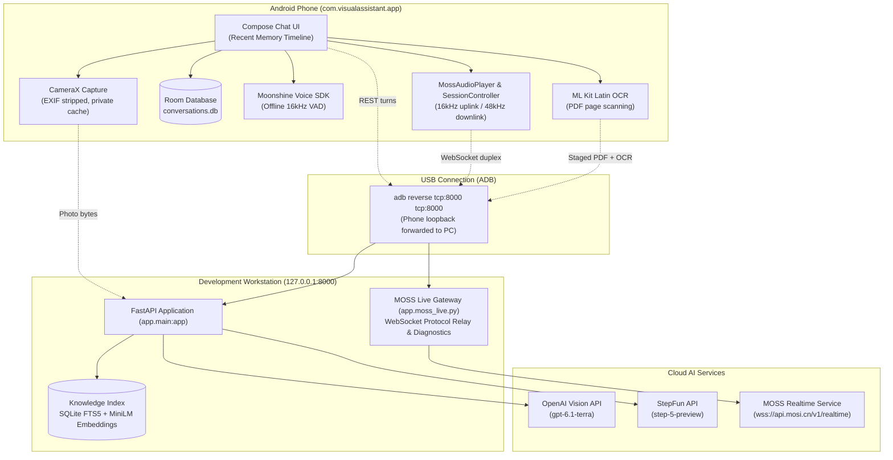
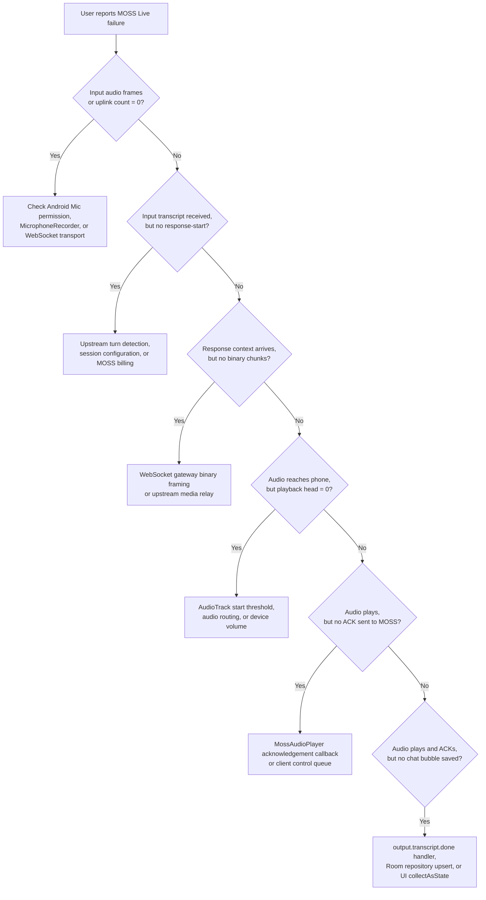

# Master Project Handoff: AI Visual Assistant

> **Updated:** 2026-11-11  
> **Target Audience:** AI Engineering Agents (Antigravity/Pair Programmer) and Human Developers  
> **Root Directory:** `C:\Users\liorc\PycharmProjects\PythonProject1`  
> **Primary Application ID:** `com.visualassistant.app`  
> **Development Ports:** `127.0.0.1:8000` / `0.0.0.0:8000` (FastAPI backend), `tcp:8000` (ADB reverse tunnel)  
> **Connectivity Modes:** Direct Wi-Fi LAN (Cable-Free) & USB Cable (ADB reverse tunnel)

---

## 1. Executive Summary & Quick Reference

This repository implements **Airflow / AI Visual Assistant for Older Adults**, a phone-first visual and conversational system designed to assist users in understanding everyday physical objects, tools, documents, and tasks.

### Core System Metadata

| Parameter | Specification | Notes / Constraints |
| :--- | :--- | :--- |
| **Current Target Hardware** | Android Phone (Android 12+, API 31+) | Supplies Camera, Mic, Speaker (Tested on Samsung Galaxy S24+) |
| **Future Hardware Target** | E12 Smart Earphones | **Not implemented** (vendor SDK/protocol unavailable) |
| **Android Tech Stack** | Kotlin 1.9+, Jetpack Compose, Room, CameraX | Min SDK 31, Target SDK 34/36, JVM target 17 |
| **Backend Tech Stack** | Python 3.13, FastAPI, Uvicorn, Pydantic v2 | Bound to `0.0.0.0:8000` (accepts USB ADB reverse & Wi-Fi Hotspot) |
| **Offline Speech Engine** | Moonshine Small Streaming (`quantized_26_11_02`) | Bundled in APK, WebRTC VAD pause detection, zero network use |
| **Realtime Voice Stream** | MOSS Live (`moss-live-1.0`) via FastAPI relay | 16 kHz mono PCM uplink, 48 kHz mono PCM downlink |
| **Assistant Providers** | OpenAI (`gpt-6.1-terra`), StepFun (`step-5-preview`) | OpenAI for general assistant; StepFun for knowledge & text-only |
| **Knowledge Engine** | Local SQLite FTS5 + MiniLM-L6-v2 embeddings | Local OCR via phone (ML Kit) or local backend (Tesseract/PaddleOCR) |

---

## 2. Interaction Modes Matrix

The assistant provides **five distinct interaction paths**. They must never be confused:

| Feature / Mode | Trigger & Input | Processing Path | Output & Persistence | Cost / Cloud Boundary |
| :--- | :--- | :--- | :--- | :--- |
| **1. Photo + Typed Question** | Camera photo review + typed prompt | Android `POST /v1/assistant/turns` &rarr; FastAPI &rarr; OpenAI / StepFun | Single assistant reply bubble in chat timeline; saved in Room DB | Billable cloud call (OpenAI or StepFun) |
| **2. Live AI Chat** | "Switch to live AI" mode | Android `POST /v1/assistant/turns` with bounded Recent Memory context (up to 8 turns) | Rolling conversation in chat timeline; saved in Room DB | Billable cloud call |
| **3. Offline Voice (Speech-to-Text)** | "Voice" button in chat; phone microphone | On-device Moonshine Small Streaming model + WebRTC VAD (~2s silence pause) | Transcribed text appears as draft chat message. **Does NOT call AI assistant** | **100% Offline & Free**; zero network transmission |
| **4. MOSS Live (Duplex Voice)** | "Start MOSS Live" button | Phone mic &rarr; 16 kHz PCM &rarr; FastAPI WS &rarr; MOSS upstream (`wss://api.mosi.cn/v1/realtime`) &rarr; 48 kHz PCM &rarr; AudioTrack | Audio played live via phone speaker; finalized transcripts persisted to Room | **Billable Realtime MOSS call**; active mic stream to cloud |
| **5. Book / Knowledge Library** | Android PDF import or CLI `add` | Phone ML Kit Latin OCR (or local OCR) &rarr; Backend SQLite FTS5 + MiniLM &rarr; StepFun tool-use | Bounded passages & approved methods retrieved to answer complex questions | Ingestion is local/offline; answering/method extraction uses StepFun |

> [!NOTE]
> The historical simulated demo route (`/v1/demo/turns`) and demo UI have been completely removed from both Android and backend.

---

## 3. System Architecture & Networking



### Network Topology & Security Boundaries

1. **Dual Network Binding:** The backend binds to `0.0.0.0:8000` on the computer so it simultaneously accepts connections from USB loopback (`127.0.0.1`) and local private Wi-Fi / Phone Mobile Hotspot interfaces (`192.168.43.x`). It is an unauthenticated development service; keep it behind private subnets/firewalls.
2. **Multi-Tier Auto-Discovery Transport:** The Android client (`OkHttpMossLiveTransport.kt`) automatically attempts:
   - *Tier 1:* Stored endpoint host (default or custom).
   - *Tier 2 (USB Loopback):* If unreachable, falls back to `ws://127.0.0.1:8000/v1/realtime/moss-live` (relayed via `adb reverse tcp:8000 tcp:8000`).
   - *Tier 3 (Automated Subnet Scanner):* If loopback is also unreachable (cable unplugged), launches `ServerScanner.kt` in the background, discovers the computer on the Wi-Fi / Hotspot subnet, validates `/health`, updates the host dynamically, and connects!
3. **API Key Isolation:** All API credentials (`MOSS_API_KEY`, `OPENAI_API_KEY`, `STEPFUN_API_KEY`) reside exclusively in the ignored `backend/.env` file on the computer. **Zero API keys are present in the Android APK or client code.**
4. **Pinned Keystore:** `android/app/build.gradle.kts` pins `signingConfigs.getByName("debug").storeFile` to `.android-user-home/debug.keystore`, ensuring all builds have identical signatures and never fail with `INSTALL_FAILED_UPDATE_INCOMPATIBLE`.

---

## 4. Subsystem Deep-Dives

### 4.1 Android Client (`android/`)

* **Package:** `com.visualassistant.app`
* **Architecture:** Jetpack Compose, Kotlin Coroutines/Flow, MVVM with Room SQLite repository.
* **Camera Pipeline:** CameraX takes reviewed snapshots. Images are auto-rotated to match sensor orientation, re-encoded without EXIF metadata, and saved in app-private `files/conversation_photos`. They are never leaked to the public Android gallery.
* **Storage & Memory Model:**
  * Room stores chats and messages in `databases/conversations.db`.
  * **Recent Memory:** A rolling 100 MiB logical content budget across conversations. Oldest completed, unsaved turns are automatically purged when capacity is reached.
  * Tapping **Save chat** locks that conversation against automatic rolling deletion.
* **Offline Voice Engine:**
  * Uses Moonshine Voice SDK 0.1.6 with the English Small Streaming model (`quantized_26_11_02`).
  * Packaged into APK assets (`android/app/src/main/assets/moonshine/small-streaming-en/`).
  * WebRTC VAD (`android-vad` 2.0.10) buffers audio and detects ~2 seconds of silence to finalize an utterance.
  * Utterances appear in chat composer as text drafts; the user must manually hit Send.
* **MOSS Live Client (`.../mosslive/`):**
  * `MossAudioPlayer.kt`: Configures an `AudioTrack` with a **1-frame start threshold** (`setStartThresholdInFrames(1)`). Default Android AudioTrack buffering waits for full capacity (e.g. 9,600 frames), which previously caused playback startup stalls on single chunks.
  * Sends continuous 16 kHz mono PCM S16LE (including silence) via WebSocket.
  * Receives 48 kHz mono PCM S16LE chunks, writes to AudioTrack, tracks playback head, and dispatches `playback.chunk.completed` and `playback.completed` acknowledgements.
  * **Continuous Visual Streaming & Heartbeat (`setCameraPhoto`):** Transmits tagged JPEG camera frames (`0x01` + JPEG bytes) over the WebSocket with a continuous 1,500ms background heartbeat coroutine (`cameraStreamJob`). This prevents MOSS's video attention buffer from timing out and ensures persistent visual awareness.
  * **Rolling Memory Photo Auto-Detection:** When MOSS Live starts, if no photo was staged in the camera view, it inspects `timeline.messages` / `recentMessages` in rolling memory to select the newest captured photo as primary visual context.
  * **Newest-First Context Ordering & Prompting:** Historical photos in `MossSessionContext` maintain newest-first order so index 0 is always the most recent image. Instructions explicitly prompt MOSS that the chat history photo is active in its live camera video stream.
  * **Dialogue History Inclusion:** Photo turns in `ChatMessage` are formatted into the instruction context as `User: [Shared a photo]` (with caption if provided), preserving conversational continuity.
  * **In-Call & Pre-Call Photo Capture:**
    * In-call: User can tap "Take Picture" during active MOSS Live; the newly snapped image immediately updates the live video stream and appends context.
    * Pre-call: In `CameraScreen`, tapping "Add to Discussion" saves the photo directly to SQLite and rolling memory without requiring typed text.
  * Transcripts: Displays live interim captions; only finalized transcripts are persisted to Room.
* **PDF & OCR Ingestion (`.../knowledge/`):**
  * Reads user-selected PDF via Android Storage Access Framework.
  * Contacts backend `POST /v1/knowledge/staging` to determine which pages lack embedded text.
  * Executes bundled Google ML Kit Latin OCR locally on the phone for degraded pages.
  * Uploads original PDF + OCR text payload to backend for SQLite FTS5 / MiniLM indexing.

### 4.2 Backend Service (`backend/`)

* **Application Factory:** `backend/app/main.py:create_app()`
* **Primary Endpoints:**
  * `GET /health`: Fast local health probe (returns `{"status": "ok"}`).
  * `POST /v1/turns`: Photo-mandatory assistant turn.
  * `POST /v1/assistant/turns`: Primary turn endpoint for the Android client. Accepts text questions, optional photos, conversation history (up to 8 turns / 4,000 characters), and `library_mode` (`auto`, `use`, `avoid`).
  * `WS /v1/realtime/moss-live`: WebSocket gateway relaying between Android and MOSS.
  * `/v1/knowledge/*`: Endpoints for staging, inspecting, and importing books from Android.
* **Provider Gateways:**
  * `OpenAIVisionGateway` (`app/openai_gateway.py`): Default provider using `gpt-6.1-terra`.
  * `StepFunGateway` (`app/stepfun_gateway.py`): Used for knowledge-assisted reasoning and text-only requests (`step-5-preview`). Supports regional endpoints (`global` or `cn`).
* **Document Library & Ingestion (`backend/app/knowledge/`):**
  * Indexes PDF, EPUB, TXT, and standalone images into `backend/.data/knowledge/library.sqlite3`.
  * Pinned embedding model: `sentence-transformers/all-MiniLM-L6-v2` downloaded via `app.knowledge.cli fetch-model` and verified by SHA-256 (`53aa5117...`).
  * Method Extraction: Extracts actionable step-by-step methods via StepFun; requires human review before inclusion in assistant prompts.
  * Budget Guard: `AGENT_MAX_ESTIMATED_USD` (default $0.10) enforces strict per-request cost bounding before invoking StepFun tools.

### 4.3 Hardware & USB Launcher

* **Launcher:** `Start MOSS Live.cmd` & `Start MOSS Live.ps1` in project root.
* **Workflow:**
  1. Locates `adb.exe` across standard SDK and system paths.
  2. Queries `adb devices` and asserts **exactly one authorized device**.
  3. Executes `adb reverse tcp:8000 tcp:8000`.
  4. Pings `http://127.0.0.1:8000/health`. If unhealthy, launches Uvicorn in the background using the project virtual environment.
  5. Launches the Android app via `adb shell monkey -p com.visualassistant.app 1`.

---

## 5. Agent Operational Guardrails & Safe Invariants

As an AI coding assistant, you MUST abide by the following strict operational rules:

> [!CAUTION]
> 1. **Zero Secret Exposure:** Never put API keys, bearer tokens, or `.env` contents into Android source, git commits, terminal logs, artifacts, or chat responses.
> 2. **Loopback Protection:** Keep backend servers and ADB reverse tunnels bound exclusively to `127.0.0.1`. Never expose to the public internet.
> 3. **Content-Free Logging:** Routine logs must omit prompt texts, image base64/bytes, audio PCM buffers, transcripts, and credentials. Log event names, run IDs, turn IDs, chunk counters, and byte counts only.
> 4. **No Spurious Live Sessions:** NEVER start a MOSS Live WebSocket session or trigger paid provider API calls merely to validate builds or run unit tests. Offline tests use mocked transports. Real sessions require explicit user authorization.
> 5. **Preserve User & Device State:** Never uninstall the app, wipe its data, reset the phone, or delete private database files (`conversations.db`, `library.sqlite3`) as a lazy troubleshooting step. Always use in-place updates: `adb install -r`.
> 6. **Root Cause Before Code:** Isolate the failing boundary (Android audio track, USB socket, FastAPI gateway, upstream MOSS) using verified evidence before editing downstream UI or database logic.

---

## 6. Known Bugs & Troubleshooting Register

Cross-referenced with [android/BUGS_AND_FIXES.md](android/BUGS_AND_FIXES.md):

| Bug ID | Component | Status | Summary & Evidence | Resolution / Current Status |
| :--- | :--- | :--- | :--- | :--- |
| **MOSS-01** | Android `MossAudioPlayer` | **Resolved & Live-Verified** | AudioTrack accepted 14,400 bytes but playback head stayed at 0; AudioFlinger logged buffer underrun. | Changed start threshold from default (full buffer capacity, e.g. 9,600 frames) to `1` frame. Verified live with 166 and 101 played chunks. |
| **MOSS-02** | MOSS Realtime | Observed historically | Phone posted user transcription but received no assistant audio. | Handshake separated from audio stream; protocol message bounds and error propagation hardened. |
| **MOSS-03** | USB / ADB Tunnel | Operational | App displayed connection error when phone was attached. | Caused by backend process being stopped or ADB reverse dropped on USB reconnect. Resolved by `Start MOSS Live.ps1`. |
| **MOSS-04** | Audio Playback Head | Resolved & Live-Verified | Premature chunk acknowledgement before actual playback head advancement. | Head progress tracked explicitly; matched provider chunk acknowledgements verified in live logs. |
| **MOSS-05** | Chat Persistence | Offline Verified | Interim/partial assistant transcript fragments were saved as corrupted chat bubbles. | Strict separation: interim captions are transient UI state; only `output.transcript.done` events are written to Room DB. |
| **MOSS-06** | Buffer Overflow | Offline Verified | Long audio streams or malformed PCM could cause queue overflow. | Bounded playback queue; turns marked incomplete if queue rejects audio. |
| **MOSS-07** | USB Launcher / Tunnel | **Observed & Diagnostics Hardened** | `Start MOSS Live.cmd` failed with "Expected 1 authorized ADB device, found 0"; starting backend manually still failed. | 1) Android hardcodes loopback (`127.0.0.1:8000`); without `adb reverse tcp:8000 tcp:8000`, the phone cannot reach the PC's backend. 2) Hardened `Start MOSS Live.ps1` to detect bundled SDK adb, auto-restart wedged adb server, and provide explicit guidance for `unauthorized` (unlock and allow prompt) vs `offline` vs missing USB connection. |
| **MOSS-08** | Acoustic Feedback / VAD Cutoff | **Diagnosed & Resolved via Software Echo Suppression** | On built-in speaker, assistant reply cut off after ~0.3s (4 chunks / 28.8 KB) due to physical speaker audio re-entering phone mic and triggering cloud VAD barge-in. Bluetooth earphones test completely eliminated cutoff. | 1) Dynamically check audio route (`AudioManager.getDevices(GET_DEVICES_OUTPUTS)`); 2) Suppress echo by transmitting zeroed 16 kHz PCM frames during built-in speaker playback plus 200ms room reverberation decay grace period; 3) Preserve natural full-duplex conversational barge-in when earphones/headsets are connected; 4) Expanded `RealtimeAudioSource` to support Bluetooth SCO, wired, and USB headset mics. |
| **MOSS-09** | Connectivity / Fallback & Client Isolation | **Diagnosed & Resolved** | Custom Wi-Fi IP setting broke USB cable mode; university Wi-Fi (`Free-TAU`) client isolation blocked direct wireless packets (`Destination Host Unreachable`). | 1) Implemented automatic fallback in `OkHttpMossLiveTransport` to `ws://127.0.0.1:8000` so cable mode always works regardless of settings; 2) Added `android:usesCleartextTraffic="true"`; 3) Documented Windows Mobile Hotspot for campus cable-free operation. |
| **MOSS-10** | Wireless Auto-Discovery & Firewall | **Resolved & Live-Verified** | Phone hotspot subnet randomized to `10.183.3.x` with PC on `.200`, blocked by Windows Public Firewall profile. | 1) Prioritized `10.183.3.200` at Priority #1 in `ServerScanner.kt`; 2) Added UDP wake listener on port 8008; 3) Created self-elevating firewall configuration in `Start MOSS Live.cmd` / `setup_firewall.ps1`. |
| **APP-01** | Camera Streaming & Visual Context | **Resolved & Live-Verified** | Video streaming during MOSS Live was previously voice-only, and pre-call rolling photos were not reached. | 1) Continuous camera video streaming (tagged `0x01` JPEG frames) with 1,500ms background heartbeat (`cameraStreamJob`); 2) In-call photo capture flow ("Take Picture"); 3) Rolling memory auto-detection (`latestRollingPhoto`); 4) Standalone pre-call capture ("Add to Discussion"); 5) Dialogue turn labeling (`User: [Shared a photo]`); 6) Newest-first photo ordering and prompt instruction. Verified live with 41 camera frames transmitted. |
| **HW-01** | E12 Smart Earphones | Not Implemented | Intended E12 BLE earphones are not integrated. | Phone supplies camera, microphone, and speaker until vendor BLE/audio protocol is provided. |

### Failure Isolation Matrix for MOSS Live



---

## 7. Verification & Command Cheat Sheet

All commands run on Windows (PowerShell) from the repository root: `C:\Users\liorc\PycharmProjects\PythonProject1`.

### Backend Verification

```powershell
# 1. Activate Python virtual environment & run offline tests (150 tests, 1 skipped)
cd backend
..\.venv\Scripts\python.exe -m pytest -q
cd ..

# 2. Check local backend health probe
curl.exe http://127.0.0.1:8000/health

# 3. Start development backend manually
cd backend
..\.venv\Scripts\python.exe -m uvicorn app.main:app --host 127.0.0.1 --port 8000
```

### Android Verification

```powershell
# 1. Fetch & checksum-verify pinned Moonshine model assets (once on fresh checkout)
powershell.exe -NoProfile -ExecutionPolicy Bypass -File .\android\scripts\fetch-moonshine-model.ps1

# 2. Run JVM unit tests (83 tests), lint, and assemble debug APKs
.\android\gradlew.bat --no-daemon --max-workers=4 --gradle-user-home .\android\.gradle-user-home -p android assembleDebug testDebugUnitTest lintDebug assembleDebugAndroidTest

# 3. In-place install on connected phone (preserves database and app state)
adb install -r android\app\build\outputs\apk\debug\app-debug.apk
```

### Live Hardware Launcher

```powershell
# Verify ADB connection, forward port 8000, start backend if needed, and open app
.\Start MOSS Live.cmd
```

---

## 8. Comprehensive Codebase Symbol & File Index

| File Path | Primary Responsibility & Key Symbols |
| :--- | :--- |
| **Root & Orchestration** | |
| [PROJECT_HANDOFF.md](PROJECT_HANDOFF.md) | **This master handoff guide**: architecture, boundaries, bugs, index. |
| [README.md](README.md) | Top-level repository overview, quickstart, and directory orientation. |
| [Start MOSS Live.ps1](Start%20MOSS%20Live.ps1) | PowerShell orchestration: single ADB device check, reverse port forwarding, Uvicorn auto-start. |
| [Start MOSS Live.cmd](Start%20MOSS%20Live.cmd) | Batch wrapper for one-click USB launcher. |
| [.gitignore](.gitignore) | Ignores `.venv/`, `.env`, build assets, model binaries, private test fixtures, and logs. |
| **Android Client (`android/`)** | |
| [android/README.md](android/README.md) | Android development guide, Moonshine asset setup, Room DB schema, lifecycle. |
| [android/BUGS_AND_FIXES.md](android/BUGS_AND_FIXES.md) | Incident history, AudioTrack threshold fix, evidence labels, diagnostic procedures. |
| [android/UI_AND_APP_PLAN.md](android/UI_AND_APP_PLAN.md) | Senior-friendly UI design principles, Compose layout specifications. |
| [android/EARPHONES_UI_PLAN.md](android/EARPHONES_UI_PLAN.md) | Specification for future E12 earphone BLE integration. |
| `android/.../mosslive/MossAudioPlayer.kt` | Manages `AudioTrack`, 1-frame threshold, 48 kHz mono PCM, chunk completion ACKs. |
| `android/.../mosslive/MossEchoSuppressor.kt` | Acoustic echo suppression on built-in speaker with room decay grace period; bypasses on earphones. |
| `android/.../mosslive/MossLiveSessionController.kt` | Realtime state machine: attach, context framing, interim transcripts, lifecycle. |
| `android/.../mosslive/MossLiveProtocol.kt` | JSON / binary protocol serializing for MOSS realtime control events. |
| `android/.../mosslive/MossLiveTransport.kt` | OkHttp WebSocket client with 3-tier fallback (configured URL &rarr; USB loopback &rarr; Wi-Fi auto-discovery). |
| `android/.../network/ServerScanner.kt` | Scans local Wi-Fi / Phone Mobile Hotspot subnet for computer backend on port 8000 + `/health`. |
| `android/.../network/AppWakeTrigger.kt` | Broadcasts UDP wake signal on app launch to trigger `Start MOSS Live.cmd` on PC. |
| `android/.../network/BackendEndpoint.kt` | SharedPreferences-backed dynamic backend endpoint with loopback default. |
| `android/.../voice/SpeechTranscriptionManager.kt` | Moonshine Small Streaming runner, WebRTC VAD pause detection (~2s). |
| `android/.../chat/ChatViewModel.kt` | Room repository binding, Recent Memory budget enforcement, timeline updates. |
| `android/.../chat/ConversationRepository.kt` | Room DAO operations, 100 MiB eviction policy, photo persistence. |
| `android/.../camera/CameraCaptureManager.kt` | CameraX integration, orientation correction, EXIF stripping. |
| `android/.../knowledge/BookImportManager.kt` | Staged PDF upload, phone-side ML Kit Latin OCR execution. |
| **Backend Service (`backend/`)** | |
| [backend/README.md](backend/README.md) | Backend guide: FastAPI endpoints, StepFun/OpenAI setup, knowledge CLI. |
| `backend/app/main.py` | FastAPI app creation (`create_app`), lifespan management, error handlers. |
| `backend/app/adb_watcher.py` | Background monitor automatically maintaining `adb reverse` whenever phone is plugged in. |
| `scripts/phone_trigger_listener.ps1` | UDP listener on port 8008 that launches `Start MOSS Live.cmd` on PC when phone app opens. |
| `backend/app/config.py` | Pydantic Settings: API keys, regional URLs, resource & token limits. |
| `backend/app/routes.py` | HTTP routes: `POST /v1/turns`, `POST /v1/assistant/turns`. |
| `backend/app/moss_live.py` | MOSS Live WebSocket gateway: upstream connection, packet relay, event counters. |
| `backend/app/assistant.py` | Multi-turn assistant orchestrator with context window budgeting. |
| `backend/app/openai_gateway.py` | OpenAI client (`gpt-6.1-terra`) adapter. |
| `backend/app/stepfun_gateway.py` | StepFun client (`step-5-preview`) adapter for knowledge & text turns. |
| `backend/app/images.py` | Image normalization, edge clamping (max 1600px), format validation. |
| `backend/app/knowledge/index.py` | SQLite FTS5 + MiniLM vector search engine (`library.sqlite3`). |
| `backend/app/knowledge/embeddings.py` | Local MiniLM (`all-MiniLM-L6-v2`) offline embedding loader. |
| `backend/app/knowledge/cli.py` | CLI commands: `fetch-model`, `add`, `list`, `search`, `remove`. |
| `backend/app/knowledge/book_import_service.py` | Staged upload coordinator for phone-scanned PDF documents. |
| **Evaluation Suite (`evaluation/`)** | |
| [evaluation/README.md](evaluation/README.md) | Privacy-preserving evaluation criteria and case preparation. |
| `evaluation/case-catalog.csv` | Catalog of 25 planned visual evaluation scenarios. |
| `evaluation/acceptance-template.csv` | Template for recording live model test outcomes. |
| [evaluation/knowledge/README.md](evaluation/knowledge/README.md) | Method extraction and retrieval quality benchmarks. |
| [evaluation/speech/README.md](evaluation/speech/README.md) | On-device speech recognition latency and accuracy evaluation plan. |
