# Dual-Mode Native Android AI Visual Assistant

*   **Author:** bull213
*   **Status:** Draft
*   **Date:** 2026-11-13

--------------------------------------------------------------------------------

## Overview

This project migrates the **Airflow / AI Visual Assistant** from a Windows PC-dependent architecture (FastAPI on Uvicorn + ADB reverse port forwarding over port 8000) into a **self-contained Android application** operating independently on a Samsung Galaxy S24+ phone.

The application operates in two distinct modes configured via a single toggle in the application settings:
1. **Standalone Mobile Mode (Default)**: The phone handles all local processing (offline speech recognition via Moonshine STT, image normalization, conversation persistence, hardware audio routing) on-device and connects directly to cloud AI services (OpenAI Vision, StepFun, MOSS Live Realtime, and Google NotebookLM) over TLS 1.3 HTTPS and WSS connections. No PC, USB cable, ADB reverse tunnel, or local network discovery is required.
2. **Workstation Mode (Optional)**: For development, debugging, and desktop testing, the phone can route requests through the existing Windows PC FastAPI backend on port 8000 (`127.0.0.1:8000` via ADB or local Wi-Fi).

All document and book intelligence (PDFs, manuals, reference texts) is delegated entirely to **Google NotebookLM**. The phone does not store, parse, index, or calculate vector embeddings for raw source documents. Users maintain their reference books inside their personal Google NotebookLM notebooks, and the phone queries them directly to vocalize grounded answers.

--------------------------------------------------------------------------------

## The Problem

The current visual assistant requires a running Windows PC executing a Python FastAPI backend on port 8000. For the phone to operate, it must either remain connected via a physical USB cable with `adb reverse tcp:8000 tcp:8000` configured, or run automated local network subnet scanning (`ServerScanner`) to locate the PC on private Wi-Fi.

This topology creates significant friction:
1. **Zero Mobility**: The user cannot use the visual assistant outside their home or away from the workstation.
2. **Complex Failure Chains**: Any network change, computer sleep state, firewall rule change, or ADB disconnect crashes the assistant.
3. **Redundant Server Relay**: The FastAPI server primarily acts as a pass-through relay for external cloud APIs (OpenAI, StepFun, MOSS Live).
4. **Heavy Mobile Ingestion Burden**: Attempting to parse raw PDFs, run OCR, and compute 384-dimensional vector embeddings on-device causes thermal throttling, memory spikes, and potential `OutOfMemoryError` crashes on the phone.

The proposed solution migrates all orchestration, WebSocket streaming, image preprocessing, and direct cloud API integration into native Kotlin on Android, while offloading all document and book intelligence to Google NotebookLM.

--------------------------------------------------------------------------------

## Goals

*   **G1: 100% PC Independence**: The application must execute all core features on a Samsung Galaxy S24+ with the PC turned completely off, requiring zero USB connections, ADB tunnels, or local network scans.
*   **G2: Direct MOSS Live Duplex Audio/Video**: Android must connect directly to `wss://api.mosi.cn/v1/realtime` with 16 kHz mono PCM uplink, 48 kHz mono PCM downlink, continuous 1500ms tagged JPEG camera heartbeat, and playback chunk acknowledgements.
*   **G3: Direct Cloud Vision & Chat**: Android must communicate directly with OpenAI Vision (`gpt-6.1-terra`) and StepFun (`step-5-preview`) over HTTPS with structured response parsing.
*   **G4: Offloaded Document Intelligence via NotebookLM**: All document, book, and manual handling must be handled by Google NotebookLM. The phone does not store or process raw book files. Standalone mobile mode connects via an in-app Google login session (with desktop QR sync fallback).
*   **G5: Zero Offline Voice Degradation**: Bundled on-device Moonshine Small Streaming STT and WebRTC VAD must remain 100% functional without an internet connection.
*   **G6: Seamless Hands-Free Switching**: Hands-free voice switching between MOSS Live, NotebookLM collections, and Moonshine STT must be fully preserved via pure-Kotlin catalog matching and a single persistent `AudioRecord` capture router.
*   **G7: Secure On-Device Key Storage**: All provider API keys (OpenAI, StepFun, MOSS Live) must be encrypted using Android Keystore-backed `EncryptedSharedPreferences` (AES-256-GCM).
*   **G8: Preserved Workstation Mode**: The existing PC backend and launcher scripts must remain intact, and the Android app must retain an optional settings toggle to route traffic through `127.0.0.1:8000` when desired.

--------------------------------------------------------------------------------

## Non-Goals

*   **NG1: On-Device Raw Book Ingestion & Parsing**: The Android app will not parse raw PDF files, render page bitmaps, run OCR, or generate local vector embeddings. All book handling is handled by Google NotebookLM.
*   **NG2: Embedded Python Runtime**: No Python interpreter (e.g., Chaquopy or Pyodide) will be packaged into the Android APK.
*   **NG3: Complete Offline Operation for Cloud AI**: The migration achieves independence from the PC, not 100% offline cloud intelligence. Cloud AI services (OpenAI, StepFun, MOSS, NotebookLM) continue to require internet access.
*   **NG4: Mandatory Paid Server Hosting**: The user is not required to deploy or pay for an intermediate cloud server or proxy. All standalone operations occur directly between the phone and provider endpoints.
*   **NG5: Database Schema Invalidation**: Existing user conversations and photos stored in `conversations.db` (Room v3) must be preserved without data loss or database wiping.

--------------------------------------------------------------------------------

## Open Questions

*   **Question 1: Google Session Cookie Longevity on Mobile**: Google session cookies (`SIDTS`, `__Secure-1PSID`) captured via the in-app WebView typically remain valid for several weeks, but Google may invalidate them upon IP changes or security checks. How should the application alert older adult users when a re-login is required?
*   **Question 2: Upstream MOSS Cellular Firewalls**: Does MOSS Live (`api.mosi.cn`) restrict connections from specific mobile cellular carrier IP ranges, or is standard TLS 1.3 WebSocket traffic universally accepted?

--------------------------------------------------------------------------------

## Critical User Journeys (CUJs)

### CUJ 1: Standalone Photo & Visual Question (PC Powered Off)

*   **Given**: The user is away from their computer with their Galaxy S24+ connected to 5G cellular or Wi-Fi. The PC backend is powered off.
*   **When**: The user opens the app, snaps a photo of an unfamiliar appliance in `CameraScreen`, types *"What does this red flashing button mean?"*, and taps Send.
*   **Then**:
    1. Android normalizes the photo on-device (clamped to 1600px edge, rotated per EXIF, composited over white).
    2. `DirectCloudAssistantGateway` dispatches an HTTPS request directly to OpenAI Vision (`gpt-6.1-terra`).
    3. The assistant returns a concise, structured reply bubble in the chat timeline, and the turn is persisted in `conversations.db` within the 100 MiB rolling memory budget.

### CUJ 2: Continuous Duplex MOSS Live with Video (Standalone)

*   **Given**: Standalone Mobile Mode is active. No USB cable is connected.
*   **When**: The user taps "Start MOSS Live with Video" from the chat timeline.
*   **Then**:
    1. `DirectMossLiveTransport` establishes a direct secure WebSocket connection to `wss://api.mosi.cn/v1/realtime?model=moss-live-1.0` with the user's Keystore-stored Bearer token.
    2. The transport completes the 2-step JSON handshake (`attach_session` &rarr; `session_attached`, `session.update` &rarr; `session.updated`).
    3. The single physical `AudioRecord` (`PhoneAudioCaptureRouter`) captures 16 kHz PCM audio; `MossEchoSuppressor` applies dynamic speaker AEC; tagged JPEG camera frames stream every 1500ms.
    4. MOSS downlink audio chunks (48 kHz PCM) play via `MossAudioPlayer` with a 1-frame threshold, acknowledging chunks back to MOSS in real time.

### CUJ 3: Hands-Free Modal Switching to a NotebookLM Collection

*   **Given**: The user is speaking in an active MOSS Live duplex call.
*   **When**: The user speaks: *"Use notebook Neuroscience, what is the dopamine pathway?"*
*   **Then**:
    1. MOSS interim transcript update recognizes the prefix *"Use notebook"*; `MossLiveSessionController` immediately suspends uplink audio and sends `response.cancel`.
    2. `VoiceCommandClassifier` extracts the target notebook (`Neuroscience`) and the trailing question (`what is the dopamine pathway?`).
    3. The app displays the grounded badge `[📚 Manual: Neuroscience]`, plays pulsing waiting earcons, and queries Google NotebookLM directly using the captured session cookies.
    4. Upon receiving the grounded answer, the earcon stops, and Android's `TextToSpeech` vocalizes the 2-sentence summary.
    5. After a 200ms acoustic decay guard, the microphone opens for follow-up questions, or the user can say *"Back to MOSS"* to resume duplex voice in <100ms.

### CUJ 4: Switching to Workstation Mode for Desktop Development

*   **Given**: The developer attaches the phone to their PC via USB and runs `Start MOSS Live.cmd`.
*   **When**: The user opens Settings and switches the "Backend Mode" toggle to "Workstation PC".
*   **Then**:
    1. `ModeRouter` switches the active transport to `RemotePCAssistantGateway` and `RemotePCMossTransport`, routing traffic to `127.0.0.1:8000`.
    2. All turns and MOSS sessions route through the PC FastAPI server, allowing inspection of local server logs and desktop Python debugging.

--------------------------------------------------------------------------------

## Technical Plan (Architecture)

### 1. Architectural Overview & Component Structure

The target architecture is a **Dual-Mode Native Android System**. A clean interface-based abstraction (`BackendModeRouter`) decouples the presentation layer from network transport details, allowing instant runtime switching between **Standalone Mobile Mode** and **Workstation PC Mode**.

```mermaid
flowchart TD
    subgraph MobileDevice["Samsung Galaxy S24+ (com.visualassistant.app)"]
        subgraph UI["Presentation Layer (Jetpack Compose)"]
            ChatUI["Chat Timeline & Composer\n(Recent Memory Budget 100 MiB)"]
            CameraUI["Camera Preview & Snapper\n(CameraX, EXIF Strip, White Canvas)"]
            SettingsUI["Settings Screen\n(Mode Toggle | BYOK Keys | QR Scanner)"]
            GoogleLoginUI["In-App Google Login WebView\n(Cookie Extraction: SIDTS, PSID)"]
        end

        subgraph AudioPipeline["Unified Hardware Audio Pipeline"]
            AudioRouter["PhoneAudioCaptureRouter\n(Single 16kHz AudioRecord Instance)"]
            MoonshineSTT["Moonshine Small Streaming\n(Bundled ONNX + WebRTC VAD)"]
            MossPlayer["MossAudioPlayer\n(48kHz AudioTrack, 1-Frame Threshold)"]
            EchoSuppressor["MossEchoSuppressor\n(Dynamic AEC + 200ms Decay Guard)"]
            AudioRouter -->|VOICE| MoonshineSTT
            AudioRouter -->|MOSS| EchoSuppressor
        end

        subgraph CoreRouting["Backend Mode Router"]
            ModeRouter["BackendModeRouter\n(Dispatches to Active Gateway Implementation)"]
        end

        subgraph StandaloneGateways["Standalone Mobile Implementation (Pure Kotlin)"]
            DirectAssistant["DirectCloudAssistantGateway\n(OkHttp -> OpenAI & StepFun)"]
            DirectMoss["DirectMossLiveTransport\n(OkHttp WSS -> wss://api.mosi.cn)"]
            DirectNLM["DirectMobileNotebookLMClient\n(Cookie-Authenticated Google RPCs)"]
            KeystoreManager["SecureCredentialStore\n(Android Keystore Encrypted AES-256)"]
        end

        subgraph WorkstationGateways["Workstation PC Implementation"]
            RemoteAssistant["RemotePCAssistantGateway\n(POST 127.0.0.1:8000/v1/assistant/turns)"]
            RemoteMoss["RemotePCMossTransport\n(WS 127.0.0.1:8000/v1/realtime/moss-live)"]
            RemoteNLM["RemotePCNotebookLMClient\n(127.0.0.1:8000 NotebookLM Proxy)"]
        end

        subgraph Persistence["Local Storage Layer"]
            ConversationsDB[("conversations.db (Room v3)\nChats, Turns, Photo Metadata")]
            PhotoFiles["files/conversation_photos/\nApp-Private Normalized JPEGs"]
        end

        ChatUI --> ModeRouter
        ModeRouter -->|Standalone Mode| DirectAssistant
        ModeRouter -->|Standalone Mode| DirectMoss
        ModeRouter -->|Standalone Mode| DirectNLM
        ModeRouter -->|Workstation Mode| RemoteAssistant
        ModeRouter -->|Workstation Mode| RemoteMoss
        ModeRouter -->|Workstation Mode| RemoteNLM

        SettingsUI --> KeystoreManager
        SettingsUI --> GoogleLoginUI
        GoogleLoginUI --> DirectNLM
        DirectMoss --> EchoSuppressor
        DirectMoss --> MossPlayer
        ChatUI --> ConversationsDB
        CameraUI --> PhotoFiles
    end

    subgraph ExternalCloud["Cloud AI Providers (Direct HTTPS / WSS)"]
        OpenAICloud["OpenAI Vision API\n(gpt-6.1-terra via HTTPS)"]
        StepFunCloud["StepFun API\n(step-5-preview via HTTPS)"]
        MOSSCloud["MOSS Realtime Service\n(wss://api.mosi.cn/v1/realtime)"]
        GoogleNLM["Google NotebookLM\n(Internal Web RPCs)"]
    end

    subgraph OptionalPC["Optional Development Workstation (127.0.0.1:8000)"]
        FastAPIServer["FastAPI Backend (app.main:app)\nUvicorn on Port 8000"]
    end

    DirectAssistant -. Direct HTTPS .-> OpenAICloud
    DirectAssistant -. Direct HTTPS .-> StepFunCloud
    DirectMoss -. Direct WSS .-> MOSSCloud
    DirectNLM -. Direct HTTPS (Cookies) .-> GoogleNLM
    RemoteAssistant -. ADB / Wi-Fi .-> FastAPIServer
    RemoteMoss -. ADB / Wi-Fi .-> FastAPIServer
    RemoteNLM -. ADB / Wi-Fi .-> FastAPIServer
```



---

### 2. Subsystem Technical Specifications

#### 2.1 Mode Routing & Interface Abstraction
To ensure zero code duplication and seamless mode switching, the application abstracts all backend operations behind three pure Kotlin interfaces:
```kotlin
interface AssistantGateway {
    suspend fun answer(question: String, photo: ByteArray?, history: List<ChatMessage>): AssistantReply
}

interface MossLiveTransport {
    fun connect(listener: MossLiveTransportListener)
    fun sendText(text: String): Boolean
    fun sendBinary(bytes: ByteArray): Boolean
    fun close(code: Int = 1000, reason: String = "Session closed")
    fun isOpen(): Boolean
}

interface NotebookLMClient {
    suspend fun listNotebooks(): List<NotebookItem>
    suspend fun askChat(notebookId: String, query: String): GroundedChatResult
    fun hasAuth(): Boolean
}
```
`BackendModeRouter` holds the active implementation references. When the user flips the toggle in Settings, `ModeRouter` switches the active instances in memory without restarting the application or modifying UI state machines.

#### 2.2 Direct Cloud Assistant Gateway (`DirectCloudAssistantGateway.kt`)
*   **Endpoint URLs**:
    *   OpenAI: `https://api.openai.com/v1/chat/completions` (or `/v1/responses`) with model `gpt-6.1-terra`.
    *   StepFun: `https://api.stepfun.ai/v1/chat/completions` (or regional endpoint) with model `step-5-preview`.
*   **Prompt Construction**:
    *   Replicates `INSTRUCTIONS` and `VISUAL_WITH_HISTORY_INSTRUCTIONS` exactly from `backend/app/assistant.py`.
    *   Enforces 60-word limits, step-by-step physical guidance, and action schema formatting (`answer`, `do_step`, `take_photo`, `clarify`, `complete`, `stop`).
    *   Assembles bounded history: up to 8 turns, maximum 4,000 characters total.
*   **Image Normalization Parity (`BitmapUtils.kt`)**:
    *   Clamps maximum edge to 1600px maintaining aspect ratio.
    *   Transposes orientation from EXIF metadata.
    *   Composites transparent PNGs onto a solid white canvas to prevent black backgrounds:
        ```kotlin
        val cleanBitmap = Bitmap.createBitmap(width, height, Bitmap.Config.RGB_565)
        val canvas = Canvas(cleanBitmap).apply { drawColor(Color.WHITE) }
        canvas.drawBitmap(sourceBitmap, 0f, 0f, null)
        cleanBitmap.compress(Bitmap.CompressFormat.JPEG, 85, outputStream)
        ```
    *   Compresses to JPEG quality 85.

#### 2.3 Direct MOSS Live Realtime Transport (`DirectMossLiveTransport.kt`)
*   **Connection**: OkHttp WebSocket connecting directly to `wss://api.mosi.cn/v1/realtime?model=moss-live-1.0`.
*   **Authentication**: Injects `Authorization: Bearer <moss_api_key>` in the WebSocket upgrade HTTP request headers.
*   **Initialization Handshake**:
    1. Outgoing on open: `{"action": "attach_session", "session_id": null}`.
    2. Incoming: `{"action": "session_attached", ...}`.
    3. Outgoing: `{"action": "session.update", "session": {"instructions": "..."}}`.
    4. Incoming: `{"action": "session.updated", ...}` &rarr; Trigger `onOpen()` callback to `MossLiveSessionController`.
*   **Streaming & Protocol**:
    *   Audio Uplink: 16 kHz mono PCM S16LE tagged with `0x00` byte prefix.
    *   Camera Uplink: JPEG compressed frames tagged with `0x01` byte prefix, streamed with a continuous 1500ms background heartbeat coroutine.
    *   Audio Downlink: 48 kHz mono PCM S16LE chunks received and fed into `MossAudioPlayer` (`AudioTrack` configured with a 1-frame start threshold).
    *   Acknowledgements: Transmits `playback.chunk.completed` and `playback.completed` matching provider run and turn IDs.
*   **Quiescent Suspension & Keepalive**:
    *   When switching to NotebookLM, `suspendAudio()` sends `{"action": "mic_state", "enabled": false}` and `{"action": "video.state", "enabled": false}`.
    *   Maintains a 15-second ping coroutine (`{"action": "ping"}`) during suspension.
    *   Closes cleanly (`code=1000`) after a 60-second quiescence timeout, auto-reconnecting transparently upon return.

#### 2.4 Option C NotebookLM Mobile Client (`DirectMobileNotebookLMClient.kt`)
*   **Authentication & In-App Sign-In (`NotebookSignInActivity.kt`)**:
    *   Hosts an Android `WebView` pointing to `https://accounts.google.com`.
    *   Configures `WebSettings.userAgentString` to match the system Chrome Mobile browser string to prevent Google 403 `disallowed_useragent` blocks.
    *   Extracts session cookies (`SIDTS`, `__Secure-1PSID`, `__Secure-1PAPISID`) via `CookieManager.getInstance().getCookie(...)` upon successful navigation to `notebooklm.google.com`.
    *   Persists cookies encrypted in `SecureCredentialStore`.
*   **Desktop QR Code Sync Fallback**:
    *   When Workstation Mode is active, a helper command on the PC (`Show Auth QR.cmd`) displays a local terminal or browser QR code encoding the valid session cookies from `storage_state.json`.
    *   The phone camera scans the QR code in Settings, immediately importing Google credentials without requiring manual typing or in-app webview login.
*   **Direct RPC Execution**:
    *   Sends authenticated HTTP requests directly to Google's internal web RPC endpoints (`https://notebooklm.google.com/_/NotebooklmUi/data/batchexecute`).
    *   Sanitizes grounded answers: strips markdown citations (`[1]`, `[2]`), footnotes, and asterisks for smooth TTS vocalization.

#### 2.5 Hardware Audio Pipeline & Single Capture Router
*   `PhoneAudioCaptureRouter`: Maintains a **single physical `AudioRecord` instance** (16 kHz mono PCM S16LE, `VOICE_COMMUNICATION` audio source). It continuously streams frames in memory to active destinations:
    *   `AudioDestination.MOSS`: Passes raw PCM through `MossEchoSuppressor` to WebSocket uplink.
    *   `AudioDestination.VOICE`: Converts raw PCM to normalized floats for Moonshine STT / WebRTC VAD.
    *   `AudioDestination.MUTED`: Drops frames to preserve hardware initialization.
*   `MossEchoSuppressor`: Dynamically zeroes uplink audio during speaker playback with a 200ms room reverberation decay grace period; completely bypassed when Bluetooth SCO or wired headphones are connected.

#### 2.6 BYOK Security & Senior-Friendly Settings Screen
*   `SecureCredentialStore`: Encapsulates `EncryptedSharedPreferences` backed by the hardware-isolated Android Keystore (`MasterKey` with AES-256-GCM).
*   `SettingsScreen`:
    *   **Backend Mode Switch**: "Standalone Mobile" (Default) vs "Workstation PC".
    *   **Assistive Key Entry**:
        1. One-tap **Clipboard Paste** with visual validation checkmarks (`✓ Key Valid`).
        2. **Camera Key Scanner**: Uses bundled offline Google ML Kit Latin OCR to scan printed API keys or computer screens.
        3. **PC Sync Button**: Automatically syncs keys from `backend/.env` over local loopback when attached to the PC.

--------------------------------------------------------------------------------

## Alternatives Considered

### Alternative A: Embedded Python Backend on Android (Chaquopy / Termux)

*   **Pros**: Reuses existing Python code without rewrite.
*   **Cons**: Adds >150 MB to APK size; Python VM + PyTorch + Uvicorn requires 450–800 MB RAM; 5–8 second cold-start latency; Android OS freezes background threads; severe battery drain and thermal throttling; frequently triggers Android Low Memory Killer during camera streaming.
*   **Reason for Rejection**: `Rejected by author: Catastrophic memory footprint (>500 MB) and cold-start latency (5-8s) on mobile; conflicts with Android process lifecycle and triggers LMK during camera streaming.`

### Alternative B: On-Device Raw Book Parsing & Vector Index (SQLite FTS5 + ONNX MiniLM)

*   **Pros**: 100% offline document search without Google account dependency.
*   **Cons**: Requires raw file storage on device, native PDF parsing library, vector embedding computation, and duplicate document library management.
*   **Reason for Rejection**: `Rejected by author: User explicitly instructed that Google NotebookLM will handle all PDFs and books, eliminating the need for the mobile application to store or process raw book sources.`

### Alternative C: On-Device PDF Image OCR Pipeline (ML Kit Latin OCR / Tesseract)

*   **Pros**: Capable of indexing scanned image-only PDF books.
*   **Cons**: Extreme CPU and GPU load; renders heavy page bitmaps causing memory spikes; slow ingestion; high thermal load and battery drain.
*   **Reason for Rejection**: `Rejected by author: Explicitly deleted from project scope to keep the application lightweight, fast, and focused on visual assistance and duplex conversation.`

### Alternative D: Single-Mode Permanent Removal of PC Backend

*   **Pros**: Simpler codebase; deletes all legacy loopback and server discovery code.
*   **Cons**: Removes desktop debugging, terminal logging, and offline developer test capabilities on the workstation.
*   **Reason for Rejection**: `Rejected by author: User explicitly requested retaining the ability to use the PC backend when connected for development, testing, and troubleshooting.`

### Alternative E: Intermediate Cloud Token Broker / KMS Server

*   **Pros**: Eliminates client-side API key storage; enables short-lived ephemeral tokens.
*   **Cons**: Violates the user's requirement for a self-contained prototype without external server infrastructure; introduces recurring cloud hosting costs, server maintenance, and an additional single point of failure.
*   **Reason for Rejection**: `Rejected by author: Introduces unnecessary recurring infrastructure costs and server maintenance for a personal prototype; on-device hardware Keystore encryption (AES-256-GCM) provides sufficient local security.`

--------------------------------------------------------------------------------

## Non-Functional Requirements

### 1. Security & Privacy
*   **BYOK Credential Protection**: User API keys (OpenAI, StepFun, MOSS Live) and Google session cookies are encrypted with AES-256-GCM using keys stored in the hardware-backed Android Keystore. Key material is never written to plain text, SharedPreferences, or log output.
*   **Network Transport**: All external network traffic is encrypted via TLS 1.3 HTTPS (`api.openai.com`, `api.stepfun.ai`, `notebooklm.google.com`) and WSS (`api.mosi.cn`). Cleartext HTTP traffic is disabled in Standalone mode.
*   **Camera Privacy**: Reviewed photo snapshots are saved exclusively in app-private storage (`files/conversation_photos/`) with EXIF metadata stripped. Photos are never written to the public Android MediaStore or gallery.

### 2. Performance & Memory Budget
*   **RAM Footprint**: Under 100 MB resident memory on Galaxy S24+ (down from >500 MB if Python had been embedded).
*   **Cold Start Latency**: Immediate UI display (<100ms) with zero VM initialization lag.
*   **Thermal Budget**: Eliminating on-device vector embedding and PDF OCR preserves thermal stability during long-running MOSS Live audio/video duplex sessions.
*   **Audio Latency**: `MossAudioPlayer` 1-frame threshold ensures immediate speech playback (<20ms start threshold), preventing AudioTrack startup underruns.

### 3. Reliability & Connectivity Handover
*   **Cellular / Wi-Fi Handover**: `DirectMossLiveTransport` catches socket disconnects during network transitions and triggers exponential backoff reconnection within the 60-second quiescent window.
*   **Senior-Friendly Error Translation**: Raw HTTP errors (401, 429, 503) are mapped to plain-English spoken and visual guidance (e.g. *"Provider is busy. Please try again in a moment."*).

--------------------------------------------------------------------------------

## Detailed Implementation Plan

The implementation is executed as a unified, ordered sequence of file modifications and additions.

### Target Files to Create / Modify / Delete

#### 1. `android/app/build.gradle.kts` (Modify)
*   **Type / Scope**: Android Build Configuration
*   **Proposed Changes**:
    *   Add `androidx.security:security-crypto:1.1.0-alpha06` for Keystore-backed AES-256-GCM encrypted storage.
    *   Add `org.jetbrains.kotlinx:kotlinx-serialization-json:1.6.3` for structured JSON model serialization.
    *   Configure Proguard rules to preserve model schemas and OkHttp WebSocket listeners.

#### 2. `android/app/src/main/AndroidManifest.xml` (Modify)
*   **Type / Scope**: Android Application Manifest
*   **Proposed Changes**:
    *   Register `NotebookSignInActivity` with `android:theme="@style/Theme.VisualAssistant"`.
    *   Add `android:usesCleartextTraffic="false"` for release builds, maintaining cleartext permissions only for loopback (`127.0.0.1`) and local subnets in debug/workstation mode.

#### 3. `android/app/src/main/java/com/visualassistant/app/network/ai/AssistantGateway.kt` (Create)
*   **Type / Scope**: Kotlin Interface
*   **Proposed Changes**:
    *   Defines the abstraction: `suspend fun answer(question: String, photo: ByteArray?, history: List<ChatMessage>): AssistantReply`.

#### 4. `android/app/src/main/java/com/visualassistant/app/network/ai/AssistantPromptTemplates.kt` (Create)
*   **Type / Scope**: Kotlin Constants
*   **Proposed Changes**:
    *   Defines `INSTRUCTIONS`, `VISUAL_WITH_HISTORY_INSTRUCTIONS`, and `TEXT_INSTRUCTIONS` identical to `backend/app/assistant.py` to maintain exact cross-platform prompt contract parity.

#### 5. `android/app/src/main/java/com/visualassistant/app/network/ai/DirectCloudAssistantGateway.kt` (Create)
*   **Type / Scope**: Kotlin Service (OkHttp)
*   **Proposed Changes**:
    *   Implements `AssistantGateway`.
    *   Makes direct HTTPS calls to `https://api.openai.com/v1/chat/completions` (OpenAI `gpt-6.1-terra`) and `https://api.stepfun.ai/v1/chat/completions` (StepFun `step-5-preview`).
    *   Assembles up to 8 history turns (max 4,000 chars) and parses `AssistantReply` (`reply: String`, `action: String`).

#### 6. `android/app/src/main/java/com/visualassistant/app/network/ai/RemotePCAssistantGateway.kt` (Create)
*   **Type / Scope**: Kotlin Service
*   **Proposed Changes**:
    *   Implements `AssistantGateway` by forwarding requests to `http://127.0.0.1:8000/v1/assistant/turns` when Workstation Mode is active.

#### 7. `android/app/src/main/java/com/visualassistant/app/chat/AndroidPhotoEncoder.kt` (Modify)
*   **Type / Scope**: Image Normalization Utility
*   **Proposed Changes**:
    *   Adds white background canvas compositing for transparent PNGs before JPEG 85 compression to eliminate black backgrounds.
    *   Clamps maximum edge to 1600px.

#### 8. `android/app/src/main/java/com/visualassistant/app/mosslive/DirectMossLiveTransport.kt` (Create)
*   **Type / Scope**: Realtime WebSocket Transport
*   **Proposed Changes**:
    *   Connects directly to `wss://api.mosi.cn/v1/realtime?model=moss-live-1.0` with `Authorization: Bearer <key>`.
    *   Executes the 2-step setup handshake (`attach_session`, `session.update`).
    *   Transmits tagged binary frames (`0x00` PCM audio, `0x01` JPEG camera frames) and chunk acknowledgements.
    *   Maintains the 15-second suspended ping loop during quiescent suspension.

#### 9. `android/app/src/main/java/com/visualassistant/app/mosslive/RemotePCMossTransport.kt` (Create / Refactor)
*   **Type / Scope**: Realtime WebSocket Transport
*   **Proposed Changes**:
    *   Refactors `OkHttpMossLiveTransport` to connect to `ws://127.0.0.1:8000/v1/realtime/moss-live` when Workstation Mode is active.

#### 10. `android/app/src/main/java/com/visualassistant/app/network/notebook/NotebookLMClient.kt` (Create)
*   **Type / Scope**: Kotlin Interface
*   **Proposed Changes**:
    *   Defines `suspend fun listNotebooks(): List<NotebookItem>`, `suspend fun askChat(notebookId: String, query: String): GroundedChatResult`, and `fun hasAuth(): Boolean`.

#### 11. `android/app/src/main/java/com/visualassistant/app/network/notebook/NotebookSignInActivity.kt` (Create)
*   **Type / Scope**: Android Activity (WebView)
*   **Proposed Changes**:
    *   Hosts `WebView` with `WebSettings.userAgentString` set to Chrome Mobile.
    *   Monitors URL redirects; upon navigating to `notebooklm.google.com`, extracts cookies (`SIDTS`, `__Secure-1PSID`) via `CookieManager` and saves into `SecureCredentialStore`.

#### 12. `android/app/src/main/java/com/visualassistant/app/network/notebook/DirectMobileNotebookLMClient.kt` (Create)
*   **Type / Scope**: Google Web RPC Client
*   **Proposed Changes**:
    *   Sends cookie-authenticated HTTPS requests to `notebooklm.google.com/_/NotebooklmUi/data/batchexecute`.
    *   Sanitizes grounded answers by removing markdown citations and footnotes before passing to TTS.

#### 13. `android/app/src/main/java/com/visualassistant/app/network/notebook/RemotePCNotebookLMClient.kt` (Create)
*   **Type / Scope**: Kotlin Service
*   **Proposed Changes**:
    *   Connects to PC backend endpoints (`/v1/notebooklm/notebooks`, `/v1/assistant/turns`) when Workstation Mode is active.

#### 14. `android/app/src/main/java/com/visualassistant/app/network/router/BackendModeRouter.kt` (Create)
*   **Type / Scope**: Core Mode Router
*   **Proposed Changes**:
    *   Reads active mode from `SecureCredentialStore`.
    *   Exposes active `AssistantGateway`, `MossLiveTransport`, and `NotebookLMClient`.
    *   Supports dynamic switching without application restart.

#### 15. `android/app/src/main/java/com/visualassistant/app/security/SecureCredentialStore.kt` (Create)
*   **Type / Scope**: Security & Credential Manager
*   **Proposed Changes**:
    *   Wraps `EncryptedSharedPreferences` backed by Android Keystore (`MasterKey`).
    *   Manages `OPENAI_API_KEY`, `STEPFUN_API_KEY`, `MOSS_API_KEY`, `GOOGLE_COOKIES`, and `BACKEND_MODE` (`STANDALONE` vs `WORKSTATION`).

#### 16. `android/app/src/main/java/com/visualassistant/app/ui/SettingsScreen.kt` (Create)
*   **Type / Scope**: Jetpack Compose Screen
*   **Proposed Changes**:
    *   Mode Selector: "Standalone Mobile" (Default) vs "Workstation PC".
    *   Masked API key input fields with Clipboard Paste buttons.
    *   Camera Key Scanner trigger (using ML Kit Latin OCR).
    *   Google NotebookLM sign-in button with active cookie status pill.

#### 17. `android/app/src/main/java/com/visualassistant/app/ui/CameraKeyScanner.kt` (Create)
*   **Type / Scope**: CameraX Scanner Component
*   **Proposed Changes**:
    *   Analyzes camera preview frames using bundled Google ML Kit Latin OCR to scan printed API keys or desktop screen QR codes.

#### 18. `scripts/show_auth_qr.py` (Create)
*   **Type / Scope**: Python CLI Script
*   **Proposed Changes**:
    *   Reads `backend/.data/notebooklm/storage_state.json` on the PC and renders a local terminal/browser QR code for quick scanning by the phone.

#### 19. `android/app/src/main/java/com/visualassistant/app/chat/ChatViewModel.kt` (Modify)
*   **Type / Scope**: Main ViewModel
*   **Proposed Changes**:
    *   Inject `BackendModeRouter` instead of hardcoded `PhoneLiveAssistant`.
    *   Wire senior-friendly error translation via `AssistantErrorMapper`.

#### 20. `android/app/src/main/java/com/visualassistant/app/knowledge/` (Deprecate / Remove)
*   **Type / Scope**: Legacy Book Ingestion Classes
*   **Proposed Changes**:
    *   Deprecate `PhoneBookImporter.kt`, `AndroidPdfOcr.kt`, and `PhoneBookImportApi.kt`, as all document handling is offloaded to NotebookLM.

---

## Verification Plan

### 1. Build & Compilation Verification
*   Execute Gradle build on local Android project:
    ```powershell
    .\android\gradlew.bat -p android assembleDebug testDebugUnitTest lintDebug
    ```
*   Verify zero duplicate `.so` collisions and zero dependency conflicts.

### 2. Standalone Automated Tests (PC Backend Shut Down)
*   **Unit Tests (`testDebugUnitTest`)**:
    *   `DirectCloudAssistantGatewayTest`: MockWebServer verifies OpenAI and StepFun JSON request headers, base64 payload, and response parsing.
    *   `DirectMossLiveTransportTest`: MockWebServer verifies WebSocket handshake, tagged binary frame packing (`0x00`/`0x01`), and chunk ACK dispatch.
    *   `BackendModeRouterTest`: Verifies dynamic switching between Standalone and Workstation gateways without state corruption.
    *   `SecureCredentialStoreTest`: Verifies Keystore encryption and persistence across mock process restarts.

### 3. Live Hardware Verification (Samsung Galaxy S24+)
*   **Test 1 (Standalone USB Disconnected)**: Disconnect USB cable, turn off PC backend. Open app, snap photo, send typed question &rarr; verify OpenAI/StepFun response within 3s.
*   **Test 2 (Duplex MOSS Live Standalone)**: Start MOSS Live with video on cellular data &rarr; verify continuous camera frame streaming, speaker AEC, and live transcription.
*   **Test 3 (Hands-Free Voice Switching)**: In MOSS Live, speak *"Use notebook [Name], [Question]"* &rarr; verify MOSS suspension, earcon tones, grounded NotebookLM reply, TTS readout, and resume via *"Back to MOSS"*.
*   **Test 4 (Workstation Mode Fallback)**: Toggle to Workstation Mode in Settings, attach USB cable, run `Start MOSS Live.cmd` &rarr; verify traffic routes to `127.0.0.1:8000`.

--------------------------------------------------------------------------------

*Drafted with EGM*
