# Technical Implementation Plan: Migrating AI Visual Assistant Backend to Android

* **Author:** bull213
* **Date:** 2026-11-13
* **Target Architecture:** Dual-Mode Native Android Architecture (Standalone Mobile by Default + Optional Workstation PC Mode)
* **Target Device:** Samsung Galaxy S24+ (Android 14 / API 34+, minimum API 31+)
* **Document Status:** Post-Goldfish Refined Blueprint

---

## Executive Summary

This document defines the comprehensive engineering plan to migrate the **Airflow / AI Visual Assistant** from its current PC-dependent topology (FastAPI on Windows + ADB reverse port forwarding over port 8000) into a **self-contained Android application** operating independently on a Samsung Galaxy S24+ phone.

In **Standalone Mobile Mode (Default)**, the phone executes all local tasks (speech-to-text, document search, conversation persistence, image preparation) on-device and connects directly to cloud AI providers (OpenAI, StepFun, MOSS Live, Google NotebookLM) over HTTPS and WSS with zero reliance on a PC, ADB tunnels, or local network discovery. In **Workstation Mode (Optional)**, the application can route through the PC's FastAPI server on port 8000 for development and desktop testing.

---

## Deliverable A: Current Architecture Audit

### 1. Codebase Verification & Component Inventory

A comprehensive inspection of the repository (`android/` and `backend/`) confirms the following distribution of responsibilities across device and workstation boundaries:

```
+---------------------------------------------------------------------------------------------------+
|                                  CURRENT TOPOLOGY (PC-DEPENDENT)                                  |
+---------------------------------------------------------------------------------------------------+
|  ANDROID PHONE (Client)                   USB / LAN BRIDGE               WINDOWS PC (FastAPI Backend)  |
|  - Jetpack Compose UI                     - ADB reverse tcp:8000         - Uvicorn on 0.0.0.0:8000   |
|  - Room DB (conversations.db v3)          - ServerScanner (UDP / HTTP)   - OpenAI Vision Gateway     |
|  - Rolling 100 MiB memory budget          - AppWakeTrigger (UDP 8008)    - StepFun Gateway           |
|  - CameraX capture & photo cache          - Start MOSS Live.cmd / .ps1   - MOSS Live WS Relay        |
|  - Moonshine Small Streaming (STT)                                       - SQLite FTS5 (library.db)  |
|  - WebRTC VAD (silence detection)                                        - MiniLM-L6-v2 Embeddings   |
|  - PhoneAudioCaptureRouter (AudioRecord)                                 - PDF text extraction       |
|  - MossAudioPlayer (48kHz AudioTrack)                                    - NotebookLM Client (Python)|
|  - MossEchoSuppressor (AEC)                                              - Playwright / Chrome Reauth|
|  - VoiceCommandClassifier (Kotlin regex)                                 - backend/.env credentials  |
+---------------------------------------------------------------------------------------------------+
```

### 2. Subsystem-by-Subsystem Audit

#### 2.1 Chat & Assistant Turns (`ChatViewModel.kt`, `LiveAssistant.kt` &rarr; `backend/app/routes.py`)
* **Current Android Implementation:**
  - `LiveAssistant.kt` (`PhoneLiveAssistant`): Captures camera JPEG, serializes recent history context (up to 8 turns / 4,000 chars), and sends a multipart `POST` to `http://127.0.0.1:8000/v1/assistant/turns`.
  - `ServerScanner.kt`: Probes subnets when `127.0.0.1:8000` fails, searching for the PC's IP address.
  - `ConversationRepository.kt`: Manages `conversations.db` in Room with rolling memory eviction (100 MiB limit) and `saved = 1` locking.
* **Current Backend Implementation:**
  - `backend/app/routes.py`: Validates image via PIL (`images.py` clamping to 1600px edge, verifying <=20MP, EXIF orientation), checks token budgets, and invokes either `OpenAIVisionGateway` (`gpt-6.1-terra`) or `StepFunGateway` (`step-5-preview`).
  - `backend/app/assistant.py`: Formats system prompts (`INSTRUCTIONS`, `VISUAL_WITH_HISTORY_INSTRUCTIONS`) and parses structured JSON output (`AssistantReply`: `reply`, `action`).

#### 2.2 Offline Voice Recognition (`SpeechTranscriptionManager.kt`, `PhoneAudioSource.kt`)
* **Current Android Implementation:**
  - 100% on-device. Bundles Moonshine Voice SDK 0.1.6 with the English Small Streaming model (`quantized_26_11_02`) in APK assets (`assets/moonshine/small-streaming-en/`).
  - Integrates WebRTC VAD (`android-vad` 2.0.10) to segment continuous microphone speech into utterances bounded by ~2.0s silence.
  - Feeds drafts into `ChatViewModel` composer.
* **Current Backend Implementation:**
  - Zero backend dependency. Completely offline.

#### 2.3 MOSS Live Duplex Voice & Video (`.../mosslive/` &rarr; `backend/app/moss_live.py`)
* **Current Android Implementation:**
  - `OkHttpMossLiveTransport.kt`: Opens an OkHttp `WebSocket` connection to `ws://127.0.0.1:8000/v1/realtime/moss-live`.
  - `PhoneAudioCaptureRouter.kt`: Manages a single physical `AudioRecord` (16 kHz mono PCM S16LE, `VOICE_COMMUNICATION` source) multiplexing frames to MOSS, Moonshine, or MUTED.
  - `MossEchoSuppressor.kt`: Dynamically zeroes uplink audio during speaker playback with a 200ms room decay grace period (bypassed on Bluetooth/wired headsets).
  - `MossAudioPlayer.kt`: Manages an `AudioTrack` with a **1-frame start threshold** (`setStartThresholdInFrames(1)`) to eliminate playback startup stalls on 48 kHz mono PCM chunks.
  - `MossLiveSessionController.kt`: State machine managing session configuration, binary uplink (`0x00` + PCM audio, `0x01` + JPEG camera frames), 1500ms video heartbeat, downlink audio buffer, interim transcripts, and playback chunk acknowledgements (`playback.chunk.completed`, `playback.completed`).
* **Current Backend Implementation:**
  - `backend/app/moss_live.py`: Acted as a pass-through proxy relay between Android and `wss://api.mosi.cn/v1/realtime?model=moss-live-1.0`.
  - Injects `Authorization: Bearer <MOSS_API_KEY>` header.
  - Executes upstream handshake: sends `{"action": "attach_session", "session_id": null}`, waits for `session_attached`, sends `{"action": "session.update", "session": {"instructions": ...}}`, waits for `session.updated`.
  - Forwards binary frames and JSON control messages between Android and MOSS.
  - Maintained 15s ping loop during quiescent suspension.

#### 2.4 Book / Knowledge Library (`PhoneBookImporter.kt` &rarr; `backend/app/knowledge/`)
* **Current Android Implementation:**
  - `PhoneBookImporter.kt`: Receives SAF URI, stages PDF locally, posts to PC `/v1/knowledge/inspect` to determine pages lacking embedded text, and posts to `/v1/knowledge/import`.
* **Current Backend Implementation:**
  - `backend/app/knowledge/index.py`: Manages `library.sqlite3` with SQLite FTS5 table `passage_fts` (`unicode61` tokenizer).
  - `backend/app/knowledge/embeddings.py`: Uses Python `sentence-transformers` to load `all-MiniLM-L6-v2` (384-dimensional float vectors, SHA-256 `53aa5117...`).
  - Search: Executes Reciprocal Rank Fusion (RRF, `k=60`) combining SQLite FTS5 BM25 lexical search with in-memory vector cosine similarity.
  - Tool Loop: `KnowledgeAssistant` (`agent.py`) coordinates a multi-round tool loop with StepFun (`step-5-preview`) using `search_library`, `open_section`, and `get_passages`.

#### 2.5 Collections / NotebookLM (`ChatViewModel.kt`, `NotebookAuthApi.kt` &rarr; `backend/app/notebooklm/`)
* **Current Android Implementation:**
  - Calls REST endpoints on PC (`/v1/notebooklm/auth/status`, `/v1/notebooklm/notebooks`, `/v1/assistant/turns` with `notebook_id`).
  - Displays grounded notebook badge `[📚 Manual: <title>]` and triggers Android TTS readout (`AndroidTextToSpeechSpeaker.kt`).
* **Current Backend Implementation:**
  - `backend/app/notebooklm/client.py`: Unofficial integration wrapping internal Google web RPCs via `notebooklm` library.
  - Headless Browser Recovery: Uses Playwright on Windows (`C:\Program Files\Google\Chrome\Application\chrome.exe` or `msedge.exe`) with a persistent desktop browser profile (`browser_profile/Default`) to re-mint expired Google session cookies (`SIDTS`, `__Secure-1PSID`).

---

## Deliverable B: Feature Migration Matrix

| Feature | Current Execution Location | PC Dependency | Proposed Execution Location | Internet Required? | Required Changes |
| :--- | :--- | :--- | :--- | :--- | :--- |
| **1. Photo + Typed Question** | Camera & UI on Android; Gateway on PC | FastAPI routes, PIL image normalization, OpenAI/StepFun Python SDKs | **100% Android** in Mobile Mode (or PC in Workstation Mode) | **Yes** (Cloud AI API call) | Implement Kotlin `OpenAiVisionClient` and `StepFunClient` using OkHttp; normalize images via Android `Bitmap` with white background compositing; read API keys from Android Keystore. |
| **2. Live AI Chat** | History in Room on Android; Context & Gateway on PC | FastAPI context budgeting, prompt assembly, OpenAI/StepFun gateways | **100% Android** in Mobile Mode (or PC in Workstation Mode) | **Yes** (Cloud AI API call) | Move `liveContext()` assembly, system prompt injection (`INSTRUCTIONS`), and structured response parsing directly into `ChatViewModel` / `LiveAssistantService`. |
| **3. Offline Voice Recognition** | 100% Android (Moonshine + WebRTC VAD) | **None** (Already fully offline on phone) | **100% Android** (Unchanged) | **No** (100% Offline) | Keep existing `SpeechTranscriptionManager`, `PhoneAudioSource`, and APK assets intact. Zero changes needed. |
| **4. MOSS Live (Duplex Voice & Video)** | Audio I/O, Video stream & AEC on Android; WebSocket relay on PC | FastAPI WebSocket proxy, Bearer token injection, session init handshake | **100% Android** in Mobile Mode (or PC in Workstation Mode) | **Yes** (Upstream MOSS Realtime API) | Connect `OkHttpMossLiveTransport` directly to `wss://api.mosi.cn/v1/realtime?model=moss-live-1.0`; inject `Authorization` header in OkHttp `Request`; perform 2-step JSON handshake (`attach_session`, `session.update`) directly in Kotlin. |
| **5. Book / Knowledge Library** | PDF picking on Android; FTS5, MiniLM & RRF on PC | SQLite FTS5 database on PC, Python MiniLM embeddings, `pypdf` text extraction, StepFun tool loop | **Hybrid: Local DB & ONNX on Android; Reasoning via Cloud** | **Local Ingestion/Search: No**<br>**StepFun Answering: Yes** | Implement independent `knowledge.db` with SQLite FTS5; run INT8 quantized `all-MiniLM-L6-v2.onnx` via ONNX Runtime Mobile; extract digital PDF text via `pdfbox-android` (**OCR deleted per user instruction**); implement Lexical-First Vector Pruning and StepFun tool-orchestration loop. |
| **6. Collections / NotebookLM** | STT, UI, Earcon & TTS on Android; Client & Browser Auth on PC | Playwright desktop automation, Chrome/Edge binary, Google cookie storage | **Android WebView Sign-In (Option C)** in Mobile Mode (or PC in Workstation Mode) | **Yes** (Google Services) | Implement in-app Android WebView for one-time Google Sign-In with customized user-agent; extract cookies (`SIDTS`, `__Secure-1PSID`) to encrypted storage; execute direct mobile RPC calls to NotebookLM; provide desktop QR code token import fallback. |
| **7. Modal Voice Switching** | Audio routing, regex matching & playback decay on Android | MOSS quiescent keepalive ping handled by PC relay | **100% Android** (Pure Kotlin) | **No for switching logic**; Yes for MOSS/Cloud turns | Keep `AudioCaptureRouter`, `VoiceCommandClassifier`, and `MossEchoSuppressor` intact; port 15s quiescent ping coroutine into `MossLiveSessionController.kt`. |

---

## Deliverable C: Recommended Target Architecture

### 1. Architectural Overview & Component Structure

```mermaid
flowchart TD
    subgraph S24Phone["Samsung Galaxy S24+ (com.visualassistant.app)"]
        subgraph PresentationLayer["Presentation Layer (Jetpack Compose)"]
            ChatUI["Chat Timeline & Composer\n(Recent Memory Budget 100 MiB)"]
            CameraUI["Camera Preview & Snapper\n(CameraX, EXIF Strip, Orientation)"]
            SettingsUI["Settings Screen\n(Mode Toggle: Standalone vs PC | BYOK Keys | QR Scanner)"]
            GoogleLoginUI["In-App Google Login WebView\n(Cookie Extraction: SIDTS, PSID)"]
        end

        subgraph CoreAudioPipeline["Unified Hardware Audio Pipeline"]
            AudioRouter["PhoneAudioCaptureRouter\n(Single 16kHz AudioRecord Instance)"]
            MoonshineSTT["Moonshine Small Streaming\n(Bundled ONNX + WebRTC VAD)"]
            MossPlayer["MossAudioPlayer\n(48kHz AudioTrack, 1-Frame Threshold)"]
            EchoSuppressor["MossEchoSuppressor\n(Dynamic AEC + 200ms Decay Guard)"]
            AudioRouter -->|VOICE| MoonshineSTT
            AudioRouter -->|MOSS| EchoSuppressor
        end

        subgraph LocalBackendServices["Local Android Service Layer (Pure Kotlin)"]
            ModeRouter["BackendModeRouter\n(Dispatches to Direct Cloud OR PC Relay)"]
            AssistantOrchestrator["AssistantOrchestrationService\n(History Budgeting & Prompt Assembly)"]
            DirectMossClient["DirectMossLiveSession\n(OkHttp WSS wss://api.mosi.cn)"]
            MobileNotebookClient["MobileNotebookLMClient\n(Cookie-Authenticated Google RPCs)"]
            KnowledgeEngine["LocalKnowledgeEngine\n(Room FTS5 + ONNX MiniLM INT8 384-dim)"]
            PdfIngestor["NativePdfTextImporter\n(pdfbox-android Text Parser - No OCR)"]
            KeystoreManager["SecureCredentialStore\n(Android Keystore Encrypted AES-256)"]
        end

        subgraph LocalDatabases["Persistent Local Storage"]
            ConversationsDB[("conversations.db (Room v3)\nChats, Turns, Photo Metadata")]
            KnowledgeDB[("knowledge.db (Room + FTS5)\nChapters, Sections, Passages, Vectors")]
            PhotoFiles["files/conversation_photos/\nApp-Private JPEGs"]
        end

        ChatUI --> ModeRouter
        ModeRouter -->|Standalone Mode| AssistantOrchestrator
        ModeRouter -->|Standalone Mode| DirectMossClient
        ModeRouter -->|Standalone Mode| MobileNotebookClient
        ModeRouter -->|Workstation Mode| LegacyPCHub["Legacy PC Transport\n(127.0.0.1:8000 via ADB/Wi-Fi)"]
        
        AssistantOrchestrator --> KnowledgeEngine
        PdfIngestor --> KnowledgeDB
        SettingsUI --> KeystoreManager
        SettingsUI --> GoogleLoginUI
        GoogleLoginUI --> MobileNotebookClient
        DirectMossClient --> EchoSuppressor
        DirectMossClient --> MossPlayer
    end

    subgraph CloudAPIs["External Cloud AI Providers (Direct HTTPS / WSS)"]
        OpenAICloud["OpenAI Vision API\n(gpt-6.1-terra via HTTPS)"]
        StepFunCloud["StepFun API\n(step-5-preview via HTTPS)"]
        MOSSCloud["MOSS Realtime Service\n(wss://api.mosi.cn/v1/realtime)"]
        GoogleNLM["Google NotebookLM\n(Internal Web RPCs)"]
    end

    subgraph OptionalPC["Optional Development Workstation (127.0.0.1:8000)"]
        FastAPIServer["FastAPI Backend (app.main:app)\nUvicorn on Port 8000"]
    end

    AssistantOrchestrator -. Direct HTTPS .-> OpenAICloud
    AssistantOrchestrator -. Direct HTTPS .-> StepFunCloud
    DirectMossClient -. Direct WSS .-> MOSSCloud
    MobileNotebookClient -. Direct HTTPS (Cookies) .-> GoogleNLM
    LegacyPCHub -. ADB / Wi-Fi .-> FastAPIServer
```



---

## Deliverable D: Architecture Comparison

* **Option A: Native Kotlin Android Backend (RECOMMENDED)**:
  - APK Overhead: ~34 MB (+12 MB ONNX Runtime Mobile + 22 MB quantized MiniLM model).
  - RAM Footprint: ~60–100 MB resident memory.
  - Cold Start: Instantaneous (<100ms).
  - Execution Stability: Native Android coroutines and lifecycles; zero process crashes on app minimize.
* **Option B: Embedded Python (Chaquopy / Pyodide) (REJECTED)**:
  - APK Overhead: >150 MB (Chaquopy + Python 3.13 + PyTorch + transformers).
  - RAM Footprint: >500 MB (triggers Android Low Memory Killer during camera streaming).
  - Cold Start: 5–8 seconds.
* **Option C / Selected Dual-Mode Hybrid**:
  - Standalone Mobile by default, with an in-app Google login for NotebookLM and an optional PC workstation mode for development.

---

## Deliverable E: Detailed Implementation Plan

### Milestone 1: Direct Cloud Gateways & Mode Router
* Implement `ModeRouter.kt` and `AssistantGateway` interface.
* Implement `DirectCloudAssistantGateway.kt` (OpenAI & StepFun via OkHttp) and `RemotePCAssistantGateway.kt` (`127.0.0.1:8000`).
* Port image normalization to Android `Bitmap` with white background compositing for transparent PNGs:
  ```kotlin
  val cleanBitmap = Bitmap.createBitmap(width, height, Bitmap.Config.RGB_565)
  val canvas = Canvas(cleanBitmap).apply { drawColor(Color.WHITE) }
  canvas.drawBitmap(sourceBitmap, 0f, 0f, null)
  cleanBitmap.compress(Bitmap.CompressFormat.JPEG, 85, outputStream)
  ```
* Assemble bounded history (up to 8 turns / 4,000 chars) and prompt templates (`INSTRUCTIONS`, `VISUAL_WITH_HISTORY_INSTRUCTIONS`).

### Milestone 2: Direct MOSS Live WebSocket Connection
* Implement `DirectMossLiveTransport.kt` connecting directly to `wss://api.mosi.cn/v1/realtime?model=moss-live-1.0`.
* Inject `Authorization: Bearer <key>` in OkHttp handshake request.
* Implement the 2-step setup handshake in Kotlin (`attach_session`, `session.update`).
* Port 15s suspended ping loop into `MossLiveSessionController.kt`.
* Implement exponential backoff reconnect on cellular/Wi-Fi handover within the 60s quiescent window.

### Milestone 3: On-Device Knowledge Engine (SQLite FTS5 + ONNX MiniLM)
* Add `packaging.jniLibs.pickFirsts.add("**/libonnxruntime*.so")` to `android/app/build.gradle.kts` to resolve Moonshine JNI collisions.
* Integrate `com.microsoft.onnxruntime:onnxruntime-android:1.17.0+`.
* Package quantized `all-MiniLM-L6-v2.onnx` (INT8, ~23 MB).
* Implement `knowledge.db` (`KnowledgeDatabase.kt`) completely isolated from `conversations.db`, with FTS5 virtual table `passage_fts` (`tokenize='unicode61'`).
* Implement **Lexical-First Vector Pruning**: Query SQLite FTS5 for top 50 BM25 candidate passages, then compute ONNX cosine similarities only on those 50 candidates, cutting matrix multiplications by >95%.
* Implement Reciprocal Rank Fusion (RRF, `k=60`).

### Milestone 4: Native PDF Text Ingestion (No OCR)
* Integrate `com.tom-roush:pdfbox-android:2.0.27.0` for structured digital text extraction.
* Ingest digital PDFs, chunk text into 1,200 character segments with 180 character overlap.
* Compute MiniLM vectors on-device and insert into `knowledge.db`.
* **Zero OCR dependencies**: Scanned pages lacking embedded text are skipped with a clear user notice.

### Milestone 5: Option C NotebookLM In-App Google Sign-In
* Implement `NotebookSignInActivity.kt` using an Android `WebView` pointing to `https://accounts.google.com`.
* Configure `WebSettings.userAgentString` to match system Chrome Mobile and enable DOM storage.
* On successful navigation to `notebooklm.google.com`, extract cookies via `CookieManager.getInstance().getCookie(...)`.
* Save `SIDTS` and `__Secure-1PSID` to `EncryptedSharedPreferences`.
* Provide a **Desktop-to-Mobile QR Transfer Fallback**: When PC backend is active, display a local QR code with authenticated cookies from `storage_state.json` for camera scan import.
* Implement `MobileNotebookLMClient.kt` calling Google's internal web RPCs (`batchexecute`) directly from Android.

### Milestone 6: Settings Screen with Backend Mode Toggle & Key Management
* Build `SettingsScreen.kt` in Jetpack Compose:
  - **Backend Mode Selector**: "Standalone Mobile" (Default) vs "Workstation PC".
  - **Provider API Keys**: OpenAI, StepFun, MOSS Live with secure validation and Keystore persistence.
  - **Senior-Friendly Key Inputs**: One-tap Clipboard Paste, In-App Camera OCR Key Scanner (scanning keys from paper/screen), and PC Sync button.
  - **Google NotebookLM**: "Sign in with Google" button with cookie status indicator.

---

## Deliverable F: Feature Preservation Checklist

- [ ] **F1: Photo + Question Single Turn:** Snapping a photo in `CameraScreen` with a typed question produces a structured reply with correct action (`answer`, `do_step`, etc.) and saves to `conversations.db`.
- [ ] **F2: Multi-Turn Live AI Chat:** Conversational history maintains up to 8 turns (4,000 chars) bounded context. Rolling memory adheres to the 100 MiB logical content budget and auto-evicts oldest unsaved turns.
- [ ] **F3: Offline Voice STT:** Moonshine Small Streaming transcribes speech completely offline with WebRTC VAD pause detection (~2s silence). No network packets emitted.
- [ ] **F4: MOSS Live Duplex Voice:**
  - [ ] 16 kHz mono PCM S16LE uplink streams continuously.
  - [ ] 48 kHz mono PCM S16LE downlink plays via phone speaker through `AudioTrack` (1-frame start threshold).
  - [ ] Playback chunk acknowledgements (`playback.chunk.completed`, `playback.completed`) are dispatched back to MOSS.
  - [ ] Software echo suppression (`MossEchoSuppressor`) mutes microphone uplink during speaker playback and applies 200ms decay guard.
  - [ ] Full natural duplex barge-in is preserved when Bluetooth/wired earphones are connected.
- [ ] **F5: MOSS Live Continuous Video Streaming:**
  - [ ] Tagged camera frames (`0x01` + JPEG) stream over WebSocket with continuous 1500ms background heartbeat.
  - [ ] Pre-call rolling photo auto-detection passes the newest chat photo as primary visual context.
  - [ ] In-call "Take Picture" snaps and updates the active live video stream immediately.
- [ ] **F6: Hands-Free Modal Voice Switching:**
  - [ ] Spoken command `"Use notebook [Title]"` suspends MOSS, opens collection, speaks TTS confirmation.
  - [ ] Compound query `"Use notebook [Title], [Question]"` switches and answers in a single breath.
  - [ ] Spoken command `"Back to MOSS"` resumes MOSS duplex within <100ms (or transparently reconnects if >60s).
  - [ ] 150ms-200ms acoustic decay guard post-TTS prevents self-transcription echo.
  - [ ] Single hardware capture router (`PhoneAudioCaptureRouter`) prevents Android 12+ `AudioFlinger` contention (`isClientSilenced = true`).
- [ ] **F7: Local Book / Knowledge Search:**
  - [ ] Digital PDF documents can be imported via Android SAF without OCR.
  - [ ] Search executes hybrid FTS5 + MiniLM ONNX retrieval locally on the phone.
- [ ] **F8: Optional Workstation Mode:**
  - [ ] Toggling to Workstation mode restores seamless communication with the PC backend on `127.0.0.1:8000`.

---

## Deliverable G: Security Plan

* **BYOK Security Model**: Users enter their own API keys in Settings.
* **Storage Encryption**: Keys and Google session cookies are encrypted with AES-256-GCM via `EncryptedSharedPreferences`. Master keys are held in hardware hardware-backed Android Keystore.
* **Network Isolation**: Direct TLS 1.3 encrypted HTTPS/WSS to provider endpoints. Cleartext traffic disabled for standalone mode.

---

## Deliverable H: Testing Strategy (PC Backend Stopped)

* **TC-01 (Standalone Mode)**: PC powered off, USB disconnected, phone on Wi-Fi &rarr; Chat, Vision, MOSS Live, Knowledge, and Collections function normally.
* **TC-02 (Mobile Data)**: Wi-Fi disabled, mobile cellular active &rarr; OkHttp connects without socket errors.
* **TC-03 (Airplane Mode)**: Moonshine STT, Book search, and conversation history work locally. Cloud turns display clean "Network unavailable" banner.
* **TC-04 (Workstation Mode Fallback)**: Enable Workstation mode, attach USB cable with `adb reverse`, start PC backend &rarr; all traffic routes through PC.
* **TC-05 (Zero-Cost CI Mocks)**: MockWebServer simulates provider responses; zero paid tokens spent during automated unit and integration tests.

---

## Deliverable I: Risks & Unresolved Questions

1. **Google Session Cookie Longevity**: Google session cookies in WebView typically last several weeks before re-authentication is required. The UI must surface clear re-login prompts.
2. **Upstream MOSS Mobile Access**: Verified that MOSS WebSocket protocol requires only Bearer token auth; no desktop-specific origin or user-agent restrictions detected.

---

## Deliverable J: Final Migration Roadmap

* **Phase 1: Direct Cloud Gateways & Mode Router** (Days 1–3): OpenAI & StepFun Kotlin clients, Bitmap normalization with white canvas compositing, ChatViewModel integration.
* **Phase 2: Direct MOSS Live WebSocket** (Days 4–6): Direct WSS transport, session handshake, video heartbeat, suspended ping loop.
* **Phase 3: On-Device Knowledge Engine** (Days 7–10): ONNX Runtime MiniLM (INT8), Room FTS5 (`knowledge.db`), Lexical-First Vector Pruning, `pdfbox-android` digital parser.
* **Phase 4: Option C NotebookLM In-App Sign-In** (Days 11–13): Android WebView cookie capture, mobile RPC client, desktop QR code token import fallback.
* **Phase 5: Mode Toggle Settings UI & Verification** (Days 14–16): Settings screen with mode switch, Keystore encryption, camera key scanner, standalone mobile testing with PC off.
