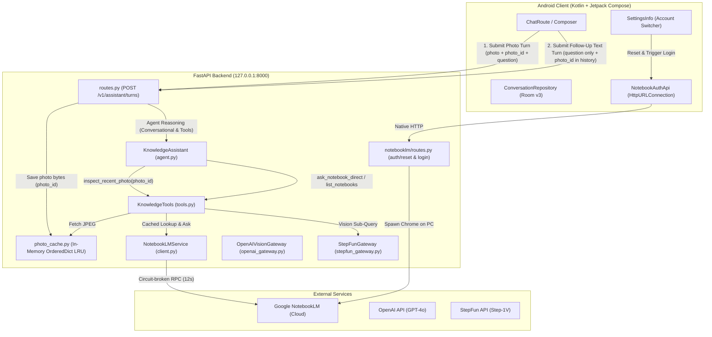

# Dynamic Image Memory Retrieval & Conversational NotebookLM Tool Integration

*   **Author:** bull213
*   **Status:** Reviewed & Hardened (Ready for Implementation)
*   **Date:** 2026-11-12

--------------------------------------------------------------------------------

## Overview

The AI Visual Assistant is designed to assist older adults with everyday tasks using visual and conversational AI. This design addresses two primary conversational breakdowns:
1. **Unintended Photo Persistence**: Currently, when a user captures an image (e.g. of a computer monitor or household appliance), the Android client continuously re-submits that photo on all subsequent turns. This causes the vision model to falsely perceive the user as still referencing the initial image, generating hallucinations and irrelevant answers on pure text and voice turns.
2. **Notebook Awareness & Natural Discovery Deficit**: When users ask conversational questions via voice or text (e.g., *"What notebooks do you have access to?"* or *"Can you check my notes on Reason is fun?"*), the assistant claims it cannot access any notebooks. The current system relies on rigid regex syntax (`@tag`), and the underlying LLM lacks system prompt grounding and first-class tool definitions to list or query the user's authenticated Google NotebookLM catalog.

This design introduces:
- **One-Shot Client Photo Attachment**: Detaching the photo after its initial submission turn, while sending `photo_id` references in rolling history context.
- **Backend Ephemeral In-Memory Photo Cache & On-Demand Visual Inspection**: Caching uploaded photos in-memory (`PhotoCache`, maxsize=5, 30-min sliding TTL) and equipping the model with an `inspect_recent_photo(photo_id)` tool using an internal vision sub-query.
- **Provider Text-Turn Support**: Hardening `OpenAIVisionGateway` and `routes.py` to support pure text turns uniformly without throwing HTTP 503 errors (`routes.py:159` and `routes.py:171`).
- **Decoupled Evidence Ledger Validation**: Updating `KnowledgeAssistant._validate_evidence` so non-SQLite tool outputs (NotebookLM citations `nlm-*` and image inspection descriptions) bypass local SQLite FTS5 passage validation.
- **First-Class Google NotebookLM Tool Suite**: Integrating `list_notebooks` and the fused `ask_notebook_direct` tool with progressive disclosure token limits (<60-word speech-friendly summaries).
- **In-App Account Switching Bridge**: Lightweight loopback endpoints (`/v1/notebooklm/auth/reset`, `/v1/notebooklm/auth/trigger-login`, `/v1/notebooklm/status`) enabling Google account switching directly from the Android settings interface using native `HttpURLConnection`.

---

## User Scenarios & Critical User Journeys (CUJs)

### CUJ 1: Decoupled Multi-Turn Appliance Help (Happy Path)
*   **Given**: The user captured a photo of a washing machine showing an error code and asked: *"What does this error mean?"* The assistant responded explaining the error.
*   **When**: The user immediately asks a follow-up text or voice question without taking a new photo: *"Where can I buy replacement detergent?"*
*   **Then**:
    1. Android detaches the photo after the first turn and sends `photo = null` with `question = "Where can I buy replacement detergent?"` and prior conversation history.
    2. The backend receives the text-only turn. It does not throw an HTTP 503 error.
    3. The assistant answers the question conversationally without falsely assuming the user is pointing at a detergent drawer or hallucinating screen details from the previous turn.

### CUJ 2: On-Demand Visual Recall via `inspect_recent_photo`
*   **Given**: The user took a photo of an appliance 3 turns ago (cached as `photo_id = "550e8400-e29b-41d4-a716-446655440000"`).
*   **When**: The user asks: *"Wait, was that red light blinking in the photo I showed you earlier?"*
*   **Then**:
    1. The model detects a reference to past visual evidence and invokes `inspect_recent_photo("550e8400-e29b-41d4-a716-446655440000")`.
    2. The backend retrieves the JPEG from `PhotoCache`, runs a dedicated vision sub-query, and returns the visual description directly inside the tool output payload (`{"status": "inspected", "description": "..."}`).
    3. The assistant accurately informs the user whether the light was illuminated without breaking provider completion schemas.

### CUJ 3: Voice Discovery & Grounded Manual Query
*   **Given**: The user is using voice input and has an appliance manual notebook named *"Reason is fun"* in NotebookLM.
*   **When**: The user speaks: *"Can you check my notes on Reason is fun and tell me what the fun criterion is?"*
*   **Then**:
    1. Moonshine transcribes the speech to text.
    2. The backend agent calls `ask_notebook_direct("Reason is fun", "what is the fun criterion")`.
    3. The tool matches the notebook from the in-memory cache and returns the grounded answer with citations in 5–7 seconds.
    4. Android renders the `[📚 Manual: Reason is fun]` citation badge and reads the response aloud via TTS.

### CUJ 4: In-App Account Switching
*   **Given**: The user has connected a Google account with 216 notebooks and wants to switch to a cleaner dedicated account.
*   **When**: The user navigates to Android Settings > "Account & Notebooks" and taps **Switch Account**.
*   **Then**:
    1. The app calls `/v1/notebooklm/auth/reset` and triggers `/v1/notebooklm/auth/trigger-login` on the host PC via native `HttpURLConnection`.
    2. The phone UI displays a waiting dialog with a 120-second timeout while Google Chrome opens on the PC for login.
    3. Once completed, the phone updates to display the new connected account email.

---

## Technical Plan (Architecture)

### Architectural Overview & Data Flow



---

### Component Specifications

#### 1. In-Memory Ephemeral Photo Cache Subsystem (`backend/app/photo_cache.py`)
- **Responsibilities**: Stores normalized JPEG images temporarily in memory on the host backend machine, making them available for on-demand visual tool inspection during subsequent follow-up turns.
- **Key Invariants**:
  - **Storage**: In-memory `collections.OrderedDict` (`maxsize=5`). Avoids NTFS file permissions, path traversal bugs, and background daemon threads on Windows host machines.
  - **Security**: The `photo_id` is validated as a UUID4 (`uuid.UUID(photo_id)`).
  - **Capacity & Expiration**: Sliding TTL of 30 minutes from last access. Least Recently Used (LRU) eviction executes when `maxsize` is exceeded.
- **Interface**:
  - `store_photo(photo_id: str, jpeg_bytes: bytes) -> None`
  - `get_photo(photo_id: str) -> bytes | None`
  - `delete_photo(photo_id: str) -> bool`
  - `clear() -> None`

#### 2. Protocol & Provider Hardening for Pure Text Turns
- **Schema Update (`backend/app/schemas.py`)**:
  - Extend `ContextMessage` with an optional `photo_id`:
    ```python
    class ContextMessage(BaseModel):
        model_config = ConfigDict(extra="forbid")
        role: Literal["user", "assistant"]
        text: Annotated[str, StringConstraints(strip_whitespace=True, min_length=1, max_length=1000)]
        photo_id: str | None = None
    ```
- **Gateway Protocol Update (`backend/app/openai_gateway.py`)**:
  - Update `VisionGateway(Protocol)`: `async def answer(self, question: str, jpeg: bytes | None = None) -> VisionResult: ...`
  - In `OpenAIVisionGateway.answer(question: str, jpeg: bytes | None = None)`:
    When `jpeg is None`, build a text-only user message: `[{"type": "input_text", "text": question}]` with `TEXT_INSTRUCTIONS` instead of crashing.
- **Route Blocker Removal (`backend/app/routes.py`)**:
  - Add `photo_id: Annotated[str | None, Form()] = None` to `create_assistant_turn`.
  - Remove line 159: `if jpeg is None and settings.assistant_provider != "stepfun": raise AssistantError(503, ...)`
  - Remove line 171: `if history or library_mode == "use": raise AssistantError(503, ...)`
  - When `image` is present, store normalized JPEG in `request.app.state.photo_cache` under `photo_id` (or generated UUID4).

#### 3. Vision Sub-Query for On-Demand Photo Inspection (`inspect_recent_photo`)
- **Problem Solved**: Provider tool APIs forbid binary images inside `{"role": "tool", "content": ...}` messages, and inserting synthetic multimodal `user` messages into active tool loops triggers HTTP 400 `invalid_request_error`.
- **Tool Specification (`backend/app/knowledge/tools.py`)**:
  - `inspect_recent_photo(photo_id: str, question: str)`: Declared as an agent tool with description *"Inspect a photograph previously captured in the conversation to examine visual details, read text, or identify objects."*
- **Execution Mechanism (`backend/app/knowledge/tools.py` & `agent.py`)**:
  1. The agent model outputs a tool call: `inspect_recent_photo(photo_id="...", question="...")`.
  2. `KnowledgeTools` fetches JPEG bytes from `photo_cache.get_photo(photo_id)`.
  3. Executes an internal dedicated vision sub-query using the provider gateway (`gateway.answer(question, jpeg)`).
  4. Returns the visual description directly inside the tool response payload:
     ```json
     {"role": "tool", "tool_call_id": "...", "content": "{\"status\": \"inspected\", \"description\": \"...\"}"}
     ```
  5. The agent completes its reasoning turn with complete visual context while keeping the agent conversation schema strictly text-based and compliant across all providers.

#### 4. Decoupled Evidence Ledger Validation (`agent.py`)
- **Problem Solved**: `KnowledgeAssistant._finalize` runs `_validate_evidence`, which mandates that `source_ids` match passages present in SQLite FTS5 table `library.sqlite3`. External tools (NotebookLM `nlm-*` citations and photo inspection) do not write to SQLite, causing answers to be discarded as `no_evidence`.
- **Validation Decoupling**:
  - In `agent.py:_validate_evidence`:
    - Local library passages are validated against `ledger.passages`.
    - External tool source IDs (e.g. `source_id.startswith("nlm-")` or inspection results) are validated against the active tool outcome records and bypass SQLite `self.index.get_passages()` checks.

#### 5. First-Class Google NotebookLM Tool Suite
- **Tool Specifications (`backend/app/knowledge/tools.py`)**:
  1. `list_notebooks(query: str | None = None, limit: int = 15)`:
     - Scans the 5-minute cached catalog in `NotebookLMService`.
     - Filters titles case-insensitively using `query` substring if provided.
     - Caps output at `limit` items to guard token budget.
  2. `ask_notebook_direct(notebook_name_or_query: str, question: str)` (Fused RAG Tool):
     - Resolves the target notebook title or ID using `find_notebook(notebook_name_or_query)` in-memory.
     - Immediately executes `ask_chat()` against the resolved ID in the same turn.
     - Eliminates the 2-round latency penalty, delivering grounded answers in 5–7 seconds.
- **Asynchronous Tool Execution**:
  - Convert `KnowledgeTools.execute` to `async def execute(self, name: str, arguments: str) -> dict`.
  - In `agent.py:368`, invoke `await tools.execute(call.function.name, call.function.arguments)`.
- **System Instructions Grounding (`backend/app/prompts.py`)**:
  - Update `CORE` and `AGENT_INSTRUCTIONS` to inform the agent:
    *"You have access to Google NotebookLM notebooks containing personal documents, appliance manuals, and guides. When the user asks what notebooks exist, call `list_notebooks`. When the user asks domain-specific or appliance questions, use `ask_notebook_direct` to look up grounded answers with citations."*
  - Increment `AGENT_PROMPT_VERSION = "source-grounded-methods-v2"`.
- **Token Guard & Progressive Disclosure**:
  - In `agent.py`, retrieved context passages injected from NotebookLM are clamped to 1,500 tokens.
  - If an answer contains extensive procedural instructions (>2,000 tokens), the model generates a concise summary (<60 words) with `action = "clarify"` and asks: *"Would you like me to read the full step-by-step instructions?"*

#### 6. In-App NotebookLM Account Switching Bridge
- **Backend Endpoints (`backend/app/notebooklm/routes.py`)**:
  - `POST /v1/notebooklm/auth/reset`: Deletes `backend/.data/notebooklm/auth_state.json` and clears in-memory caches.
  - `POST /v1/notebooklm/auth/trigger-login`: Spawns the PC browser login task (`cli.py login`) asynchronously on the host machine.
  - `GET /v1/notebooklm/status`: Returns `{"configured": true, "authenticated": true/false, "email": "user@gmail.com"}`.
- **Android Networking Client (`NotebookAuthApi.kt`)**:
  - Implements lightweight HTTP calls via native `HttpURLConnection` and `BackendEndpoint.httpUrl()`, matching `PhoneLiveAssistant` and `ServerScanner` (no Retrofit dependency).
  - Methods: `getStatus(): NotebookAuthStatus`, `resetAuth(): Boolean`, `triggerLogin(): Boolean`.
- **Android Settings UI (`SettingsInfo.kt`)**:
  - Adds an **Account & Notebooks** card in the Settings sidebar.
  - Displays connection badge with verified email and status indicator.
  - Provides a **Switch Account** button that sends reset and trigger requests, displays an in-app waiting dialog, and polls `/v1/notebooklm/status` (every 2s, 120s timeout) with a Cancel button.

#### 7. Android Client One-Shot Photo Detachment
- **Composer & Detachment Lifecycle (`ChatRoute.kt`)**:
  - Refactor `selectedPhoto`:
    ```kotlin
    val selectedPhoto = cameraState.photo?.takeIf { it.id == sessionPhotoId }
        ?: (chatState.currentPhoto ?: latestRecentPhoto).takeIf { chatState.attachPhoto }
    ```
  - In `onSend`, reset `sessionPhotoId = null` synchronously upon turn submission.
  - The photo appears in the chat timeline bubble (`ChatKind.PHOTO`), providing visual confirmation, but is removed from the active composer.
  - Subsequent turns send `photo = null`.
- **History Context Mapping (`LiveAssistant.kt` & `LiveProtocol.kt`)**:
  - Update `liveContext` in `LiveAssistant.kt` to extract `photoId` by matching `turnId` with preceding `ChatKind.PHOTO` messages.
  - In `LiveProtocol.kt`, serialize `photo_id` into `history_json` and send `photo_id` in multipart form data when `image != null`.

---

## Detailed Implementation Plan

### Unified File Enumeration & Rationale

#### Backend Components (`backend/`)

1. **[backend/app/photo_cache.py](file:///c:/Users/liorc/PycharmProjects/PythonProject1/backend/app/photo_cache.py)** *(New)*:
   - *Rationale*: Implements the in-memory ephemeral cache for uploaded photographs. Stores normalized images in an `OrderedDict(maxsize=5)` with 30-minute sliding TTL and UUID validation. Supports on-demand visual recall (`inspect_recent_photo`) without disk I/O or daemon threads.

2. **[backend/app/schemas.py](file:///c:/Users/liorc/PycharmProjects/PythonProject1/backend/app/schemas.py)** *(Modify)*:
   - *Rationale*: Add `photo_id: str | None = None` to `ContextMessage`. Because `ContextMessage` enforces `extra="forbid"`, any request from Android containing `photo_id` in `history_json` crashes with HTTP 422 unless explicitly declared.

3. **[backend/app/openai_gateway.py](file:///c:/Users/liorc/PycharmProjects/PythonProject1/backend/app/openai_gateway.py)** *(Modify)*:
   - *Rationale*: Update `VisionGateway(Protocol)` and `OpenAIVisionGateway.answer(question: str, jpeg: bytes | None = None) -> VisionResult` to support `jpeg = None`. Use `{"type": "input_text", "text": question}` with `TEXT_INSTRUCTIONS` when `jpeg is None`.

4. **[backend/app/main.py](file:///c:/Users/liorc/PycharmProjects/PythonProject1/backend/app/main.py)** *(Modify)*:
   - *Rationale*: Wire `app.state.photo_cache = PhotoCache()` during application lifespan initialization.

5. **[backend/app/routes.py](file:///c:/Users/liorc/PycharmProjects/PythonProject1/backend/app/routes.py)** *(Modify)*:
   - *Rationale*:
     - Add `photo_id: Annotated[str | None, Form()] = None` to `create_assistant_turn`.
     - Remove `routes.py:159` (`jpeg is None` check) and `routes.py:171` (`history` check).
     - When `image` is present, store normalized image bytes into `photo_cache` keyed by request `photo_id`.
     - Route text follow-ups with history cleanly through `KnowledgeAssistant`.

6. **[backend/app/knowledge/tools.py](file:///c:/Users/liorc/PycharmProjects/PythonProject1/backend/app/knowledge/tools.py)** *(Modify)*:
   - *Rationale*:
     - Register `inspect_recent_photo(photo_id: str, question: str)` tool specification.
     - Register `list_notebooks(query: str | None = None, limit: int = 15)` tool specification.
     - Register fused `ask_notebook_direct(notebook_name_or_query: str, question: str)` tool specification.
     - Update constructor: `KnowledgeTools.__init__(self, index, ledger, history, photo_cache=None, notebooklm_service=None, gateway=None)`.
     - Convert `execute` to `async def execute(self, name: str, arguments: str) -> dict`.

7. **[backend/app/knowledge/agent.py](file:///c:/Users/liorc/PycharmProjects/PythonProject1/backend/app/knowledge/agent.py)** *(Modify)*:
   - *Rationale*:
     - Update constructor: `KnowledgeAssistant.__init__(self, gateway, index, settings, notebooklm_service=None, photo_cache=None)`.
     - Update `_process_tool_calls` to call `await tools.execute(...)`.
     - In `_validate_evidence`: decouple validation so external tool source IDs (`nlm-*` and photo inspection) bypass SQLite passage ledger checks.
     - Add token context clamping (1,500 tokens) and progressive disclosure formatting for manual responses.

8. **[backend/app/notebooklm/client.py](file:///c:/Users/liorc/PycharmProjects/PythonProject1/backend/app/notebooklm/client.py)** *(Modify)*:
   - *Rationale*: Ensure `list_notebooks` and `find_notebook` support limit capping and case-insensitive substring filtering directly over the in-memory cache.

9. **[backend/app/notebooklm/routes.py](file:///c:/Users/liorc/PycharmProjects/PythonProject1/backend/app/notebooklm/routes.py)** *(Modify)*:
   - *Rationale*: Expose `POST /v1/notebooklm/auth/reset` to delete `auth_state.json` and reset cache, and `POST /v1/notebooklm/auth/trigger-login` to spawn PC browser login in background for in-app account switching.

10. **[backend/app/prompts.py](file:///c:/Users/liorc/PycharmProjects/PythonProject1/backend/app/prompts.py)** *(Modify)*:
    - *Rationale*: Update `CORE` and `AGENT_INSTRUCTIONS` to ground the model in NotebookLM capabilities (`list_notebooks`, `ask_notebook_direct`). Bump `AGENT_PROMPT_VERSION = "source-grounded-methods-v2"`.

11. **[backend/tests/test_photo_cache.py](file:///c:/Users/liorc/PycharmProjects/PythonProject1/backend/tests/test_photo_cache.py)** *(New)*:
    - *Rationale*: Pytest test suite verifying photo cache write, read, TTL expiration, LRU eviction, and UUID validation.

12. **[backend/tests/test_notebooklm_rag.py](file:///c:/Users/liorc/PycharmProjects/PythonProject1/backend/tests/test_notebooklm_rag.py)** *(Modify)*:
    - *Rationale*: Add unit test coverage for `list_notebooks` and fused `ask_notebook_direct` tool handlers.

13. **[backend/tests/test_assistant_route.py](file:///c:/Users/liorc/PycharmProjects/PythonProject1/backend/tests/test_assistant_route.py)** *(Modify)*:
    - *Rationale*: Add tests ensuring pure text turns succeed under `assistant_provider = "openai"` without throwing 503, and test `ContextMessage` with `photo_id`.

#### Android Client Components (`android/`)

14. **[android/app/src/main/java/com/visualassistant/app/ui/ChatRoute.kt](file:///c:/Users/liorc/PycharmProjects/PythonProject1/android/app/src/main/java/com/visualassistant/app/ui/ChatRoute.kt)** *(Modify)*:
    - *Rationale*: Update `selectedPhoto` expression to check `chatState.attachPhoto` fallback. In `onSend`, reset `sessionPhotoId = null` synchronously upon submission.

15. **[android/app/src/main/java/com/visualassistant/app/chat/LiveAssistant.kt](file:///c:/Users/liorc/PycharmProjects/PythonProject1/android/app/src/main/java/com/visualassistant/app/chat/LiveAssistant.kt)** *(Modify)*:
    - *Rationale*: Update `liveContext` to return `LiveHistoryItem(role, text, photoId)`, matching `turnId` of paired `ChatKind.PHOTO` messages. Pass `photo?.id` to `LiveProtocol.requestBody`.

16. **[android/app/src/main/java/com/visualassistant/app/chat/LiveProtocol.kt](file:///c:/Users/liorc/PycharmProjects/PythonProject1/android/app/src/main/java/com/visualassistant/app/chat/LiveProtocol.kt)** *(Modify)*:
    - *Rationale*: Update `requestBody` to accept `photoId: String? = null` and write `photo_id` multipart field. Update `historyJson` to serialize `photo_id` when present.

17. **[android/app/src/main/java/com/visualassistant/app/network/NotebookAuthApi.kt](file:///c:/Users/liorc/PycharmProjects/PythonProject1/android/app/src/main/java/com/visualassistant/app/network/NotebookAuthApi.kt)** *(New)*:
    - *Rationale*: Native Kotlin client using `BackendEndpoint` and `HttpURLConnection` for `/v1/notebooklm/auth/reset`, `/v1/notebooklm/auth/trigger-login`, and `/v1/notebooklm/status`.

18. **[android/app/src/main/res/values/strings.xml](file:///c:/Users/liorc/PycharmProjects/PythonProject1/android/app/src/main/res/values/strings.xml)** *(Modify)*:
    - *Rationale*: Add localized strings for the Account & Notebooks settings card and browser waiting dialog.

19. **[android/app/src/main/java/com/visualassistant/app/ui/SettingsInfo.kt](file:///c:/Users/liorc/PycharmProjects/PythonProject1/android/app/src/main/java/com/visualassistant/app/ui/SettingsInfo.kt)** *(Modify)*:
    - *Rationale*: Add "Account & Notebooks" card displaying the connected Google account email, status indicator, and a **Switch Account** button with a 120s polling state machine.

20. **[android/app/src/test/java/com/visualassistant/app/chat/ChatViewModelTest.kt](file:///c:/Users/liorc/PycharmProjects/PythonProject1/android/app/src/test/java/com/visualassistant/app/chat/ChatViewModelTest.kt)** *(Modify)*:
    - *Rationale*: Unit test verifying one-shot detachment and `photo_id` mapping in rolling context.

#### Documentation & EGM Contracts

21. **[backend/app/README.md](file:///c:/Users/liorc/PycharmProjects/PythonProject1/backend/app/README.md)**, **[backend/app/knowledge/README.md](file:///c:/Users/liorc/PycharmProjects/PythonProject1/backend/app/knowledge/README.md)**, **[backend/app/notebooklm/README.md](file:///c:/Users/liorc/PycharmProjects/PythonProject1/backend/app/notebooklm/README.md)**, **[android/app/src/main/java/com/visualassistant/app/chat/README.md](file:///c:/Users/liorc/PycharmProjects/PythonProject1/android/app/src/main/java/com/visualassistant/app/chat/README.md)** *(Modify)*:
    - *Rationale*: Update EGM architectural contracts to document the `photo_cache` subsystem, NotebookLM tool specifications, and one-shot photo detachment lifecycle.
