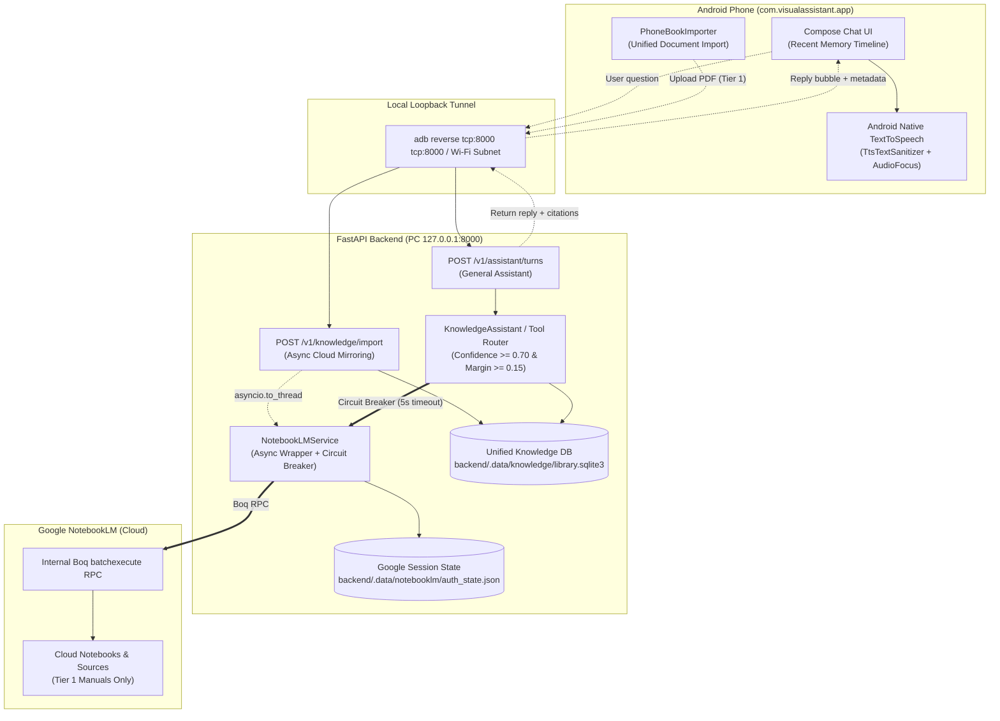

# NotebookLM Specialized RAG & Voice Delegation

| Metadata | Details |
| :--- | :--- |
| **Author** | bull213 |
| **Status** | Approved Specification |
| **Date** | 2026-11-12 |
| **Reviewers** | EGM Goldfish Review Swarm (`egm-zoom-out`, `egm-inventive-catalyst`, `egm-comprehension`, `egm-design`, `egm-structural`, `egm-codebase-details`, `egm-implementation-readiness`) |

--------------------------------------------------------------------------------

## Overview

This specification establishes the architecture for integrating [`teng-lin/notebooklm-py`](https://github.com/teng-lin/notebooklm-py) into the **AI Visual Assistant (Airflow)** platform as a **Specialized RAG (Retrieval-Augmented Generation) Co-processor**. 

When an older adult asks a domain-specific question regarding an everyday appliance or tool manual, the primary conversational assistant automatically delegates the query to the corresponding Google NotebookLM notebook via local loopback RPC. 
The grounded answer with source citations is returned, sanitized of raw syntax markers, and read aloud using on-device speech synthesis (Android native `TextToSpeech`).

Crucially, to preserve the system's simple, hands-free design for older adults, the architecture eliminates separate cloud container management: documents imported through the existing unified document flow ([`PhoneBookImporter.kt`](../../android/app/src/main/java/com/visualassistant/app/knowledge/PhoneBookImporter.kt)) are mirrored to NotebookLM in the background, without requiring older adults to curate or navigate cloud notebooks.

### Terminology & Glossary
*   **RAG (Retrieval-Augmented Generation)**: Augmenting language model prompts with passages retrieved from indexed external documents.
*   **Boq RPC**: Google's internal web application framework and reverse-engineered `batchexecute` protocol used by `notebooklm-py` to interact with Google NotebookLM over HTTP.
*   **StepFun**: The cloud AI provider (`step-5-preview`) used by Airflow for complex tool-use reasoning and local document knowledge retrieval.
*   **SAF (Storage Access Framework)**: Android's secure system file picker contract used by users to select local documents.

--------------------------------------------------------------------------------

## The Problem

Older adults using Airflow frequently face dense, complex paperwork—appliance operation manuals, device setup guides, and technical warranties. 
While Airflow handles single-turn physical photo questions and simple keyword searches over local documents, it exhibits two structural limitations:

1. **Context Window & Cross-Page Synthesis Limits**: The local SQLite FTS5 + MiniLM system struggles with complex, cross-page reasoning across 50+ page technical manuals without exceeding token budgets or returning fragmented passages.
2. **Reading Barrier**: Older adults often experience vision impairments or cognitive fatigue, making reading multi-paragraph textual explanations on a mobile device screen challenging.

### Privacy Segmentation
To strictly adhere to `PROJECT_HANDOFF.md` Guardrail 1 (*Zero Secret / PII Cloud Exposure*):
*   **Tier 1 (Public Appliance & Tool Manuals)**: Eligible for cloud mirroring to Google NotebookLM.
*   **Tier 2 (Sensitive Personal Health & Legal Documents)**: Prescription medication schedules, doctor discharge notes, and financial paperwork are **strictly quarantined** to on-device and local SQLite FTS5 processing. They are never transmitted to Google NotebookLM.

--------------------------------------------------------------------------------

## Goals

*   **Hands-Free Grounded Delegation**: Automatically identify when an appliance/tool query matches an imported manual, query Google NotebookLM via `notebooklm-py`, and deliver grounded answers with citations.
*   **Safe Speech Delivery**: Automatically synthesize and speak answers using Android's native `TextToSpeech` with transient audio focus, VAD echo protection, and tap-to-stop control.
*   **Unified Ingestion**: Mirror Tier 1 documents to NotebookLM automatically through the existing [`PhoneBookImporter.kt`](../../android/app/src/main/java/com/visualassistant/app/knowledge/PhoneBookImporter.kt) pipeline, avoiding duplicate UI screens or parallel databases.
*   **Resilient Fallback**: Protect live conversational turns with a strict 5.0-second Boq RPC timeout and automatic, graceful fallback to the general assistant or local SQLite engine if the cloud RPC fails or expires.
*   **MOSS Live Audio Protection**: Offload all synchronous network and SQLite I/O to thread pools via `asyncio.to_thread` to guarantee zero latency jitter or buffer underruns on concurrent MOSS Live duplex audio streams.
*   **Credential Isolation**: Quarantining Google session cookies (`auth_state.json`) strictly on the PC backend under `backend/.data/notebooklm/`.
*   **Deterministic Offline Verification**: Pytest suite verifying all routes, circuit breakers, and room migrations with zero live external network calls.

## Non-Goals

*   **Artifact Generation**: Generation of NotebookLM Audio Overviews (2-speaker podcasts), slide decks, study guides, or mind maps is explicitly excluded.
*   **Cloud Ingestion of Sensitive Paperwork**: Personal medical records or prescription schedules will not be synced to NotebookLM.
*   **Direct Phone-to-Google Communication**: Android communicates exclusively with the local loopback backend via ADB reverse (`tcp:8000`) or private Wi-Fi.
*   **Replacing Local SQLite FTS5**: The existing local document library remains active for offline and low-latency basic lookups.

--------------------------------------------------------------------------------

## Critical User Journeys (CUJs)

### CUJ 1: Importing an Appliance Manual
*   **Given**: The user has the Android app open and connected to the backend via USB or local Wi-Fi.
*   **When**: The user imports a PDF manual (e.g., "Washing Machine Manual") through the standard document import screen.
*   **Then**: 
    1. The app uploads the PDF to `POST /v1/knowledge/import`.
    2. The backend indexes the document locally into `library.sqlite3`.
    3. The backend returns `202 Accepted` to the app while asynchronously creating a NotebookLM notebook and uploading the source in the background.
    4. The backend updates the document record with `notebooklm_id` and status `READY` once Google finishes indexing.

### CUJ 2: Automatic Query Delegation and Voice Readout
*   **Given**: A manual titled "Washing Machine Manual" is indexed and in `READY` status.
*   **When**: In the standard chat screen, the user asks: *"How do I clean the drain pump filter on my washing machine?"*
*   **Then**: 
    1. The assistant router scores the query against indexed manuals; confidence exceeds the threshold ($\ge 0.70$).
    2. The backend queries NotebookLM's chat endpoint with a 5.0s timeout.
    3. The grounded answer with citations is returned in `AssistantTurnResponse` with `notebook_title="Washing Machine Manual"` and `read_aloud=true`.
    4. The chat UI renders a bubble with a `[📚 Manual: Washing Machine Manual]` badge.
    5. Android `TextToSpeech` acquires audio focus, sanitizes markdown/citations, and speaks the answer aloud.

--------------------------------------------------------------------------------

## Architecture

### 1. Backend Service Layer (`backend/app/notebooklm/`)
*   **`client.py` (`NotebookLMService`)**:
    *   Initializes `NotebookLMClient` from `backend/.data/notebooklm/auth_state.json`.
    *   All network and disk operations execute via `asyncio.to_thread` to prevent starving MOSS Live duplex audio.
    *   Exposes `ask_chat(notebook_id, question, timeout=5.0)`.
    *   **Circuit Breaker**: On Boq RPC failure, timeout, or 401, catches error, logs warning without PII, and returns fallback response.
*   **Unified Knowledge DB Integration (`backend/app/knowledge/index.py`)**:
    *   No separate `registry.sqlite3`.
    *   Alters existing `documents` table in `library.sqlite3`:
        *   `notebooklm_id TEXT DEFAULT NULL`
        *   `notebooklm_status TEXT DEFAULT 'NONE'` (`NONE`, `PROCESSING`, `READY`, `FAILED`)
        *   `privacy_tier TEXT DEFAULT 'TIER_1'` (`TIER_1_PUBLIC`, `TIER_2_SENSITIVE`)
*   **`cli.py`**:
    *   `python -m app.notebooklm.cli login`: Launches headful Chromium to authenticate and save `auth_state.json`.
    *   `python -m app.notebooklm.cli status`: Validates stored credentials and reports session expiry.

### 2. Conversational Intent Routing (`backend/app/knowledge/agent.py`)
*   **Matching Algorithm**:
    *   Matches question against indexed manuals using existing MiniLM cosine similarity.
    *   Gating threshold: $\ge 0.70$ similarity and margin $\ge 0.15$ over runner-up.
    *   If confidence is below threshold or query is ambiguous across two manuals, falls back to general reasoning or asks a conversational disambiguation question (*"Are you asking about your washer or dishwasher?"*).
    *   Delegation strictly checks `privacy_tier == 'TIER_1'` and `notebooklm_status == 'READY'`.

### 3. Android Client Speech & UI Integration (`android/`)
*   **`AndroidTextToSpeechSpeaker.kt`** (in `com.visualassistant.app.voice`):
    *   Wraps `android.speech.tts.TextToSpeech`.
    *   Acquires `AUDIOFOCUS_GAIN_TRANSIENT_MAY_DUCK` from `AudioManager`.
    *   Implements `TtsTextSanitizer`: strips markdown headers, asterisks, bullet points, and citation markers (`[1]`, `[2]`).
    *   Signals `SpeechController` to pause Moonshine VAD during speech output to prevent acoustic feedback (Bug MOSS-08).
    *   Binds tap-on-bubble to `stop()` for immediate silencing.
*   **`LiveProtocol.kt` & `LiveAssistant.kt`**:
    *   Parses structured response: `AssistantTurnResult(reply, notebookTitle, readAloud, retrievalStatus, sources)`.
*   **`ConversationDatabase.kt` & Room Migration**:
    *   Increments Room `version = 3`.
    *   Implements `MIGRATION_2_3`: `ALTER TABLE messages ADD COLUMN notebookTitle TEXT`.

--------------------------------------------------------------------------------

## Alternatives Considered

| Approach | Pros | Cons | Reason for Rejection |
| :--- | :--- | :--- | :--- |
| **Alternative A: Parallel SQLite Registry & Separate UI** | Complete decoupling from local knowledge code. | Duplicates `library.sqlite3` and `PhoneBookImporter.kt`; forces older adults to manage cloud containers. | Rejected by author: Violates YAGNI and creates cognitive burden for older adults. |
| **Alternative B: Syncing Medical / PHI Paperwork to Cloud** | Full reasoning across doctor discharge notes. | Directly violates project privacy boundaries (`PROJECT_HANDOFF.md` Guardrail 1) via unverified web scrapers. | Rejected by author: Privacy compromise unacceptable; medical data must stay local. |
| **Alternative C: Unhedged Synchronous Boq RPC** | Simpler linear code path. | Unstable RPC cold starts hang assistant turns; crashes turns on cookie expiry; starves MOSS Live audio. | Rejected by author: Assistant must be resilient; circuit breaker and threadpool offloading mandatory. |

--------------------------------------------------------------------------------

## Detailed Implementation Plan

### Backend Components (`backend/`)
1. **`backend/requirements.txt` [MODIFY]**:
   - Add `notebooklm-py[browser]>=0.1.0`. Document running `playwright install chromium`.
2. **`backend/app/config.py` [MODIFY]**:
   - Add `notebooklm_data_dir: Path = BACKEND_DIR / ".data" / "notebooklm"` to `Settings`.
3. **`backend/app/security.py` [NEW]**:
   - Centralize `_require_loopback` and subnet validation shared across knowledge and notebooklm modules.
4. **`backend/app/notebooklm/client.py` [NEW]**:
   - `NotebookLMService` with threadpool offloading (`asyncio.to_thread`) and circuit breaker.
5. **`backend/app/notebooklm/cli.py` [NEW]**:
   - CLI login and status validation tool.
6. **`backend/app/knowledge/index.py` [MODIFY]**:
   - Alter `documents` table to add `notebooklm_id`, `notebooklm_status`, and `privacy_tier`.
7. **`backend/app/knowledge/agent.py` [MODIFY]**:
   - Add confidence-gated NotebookLM routing ($\ge 0.70$) with local SQLite fallback.
8. **`backend/app/schemas.py` [MODIFY]**:
   - Add `notebook_title: str | None = None` and `read_aloud: bool = False` to `AssistantTurnResponse`.
   - Update `retrieval_status` to include `"notebooklm"`.
9. **`backend/app/main.py` [MODIFY]**:
   - Initialize `NotebookLMService` in `lifespan` under `app.state`.
10. **`backend/app/routes.py` [MODIFY]**:
    - Wire notebook delegation in `create_assistant_turn`.
11. **`backend/tests/test_notebooklm_rag.py` [NEW]**:
    - Pytest mock suite testing 401 auth expiration, 503 RPC timeout, circuit breaker fallback, and schema validation.

### Android Components (`android/`)
1. **`android/app/src/main/java/com/visualassistant/app/voice/AndroidTextToSpeechSpeaker.kt` [NEW]**:
   - Android native TTS with `TtsTextSanitizer`, audio focus request, and VAD pause signaling.
2. **`android/app/src/main/java/com/visualassistant/app/chat/ConversationDatabase.kt` [MODIFY]**:
   - Increment Room `version = 3`, implement `MIGRATION_2_3` (`ALTER TABLE messages ADD COLUMN notebookTitle TEXT`), register in provider.
3. **`android/app/src/main/java/com/visualassistant/app/chat/ChatModels.kt` [MODIFY]**:
   - Add `notebookTitle: String? = null` and `readAloud: Boolean = false` to `ChatMessage`.
4. **`android/app/src/main/java/com/visualassistant/app/chat/LiveProtocol.kt` [MODIFY]**:
   - Parse structured turn result (`reply`, `notebook_title`, `read_aloud`, `retrieval_status`).
5. **`android/app/src/main/java/com/visualassistant/app/chat/LiveAssistant.kt` [MODIFY]**:
   - Change `LiveAssistant.answer` return type to `AssistantTurnResult`.
6. **`android/app/src/main/java/com/visualassistant/app/chat/ChatViewModel.kt` [MODIFY]**:
   - Trigger speech readout on incoming turn when `readAloud` is true, handle replay and tap-to-stop.
7. **`android/app/src/main/java/com/visualassistant/app/ui/ChatMessageItems.kt` [MODIFY]**:
   - Render `[📚 Manual: ...]` badge, speaker replay icon, and tap-to-stop active state.
8. **`android/app/src/test/java/com/visualassistant/app/chat/ChatViewModelTest.kt` [MODIFY]**:
   - Unit test verifying `readAloud` triggers speech and stores `notebookTitle`.
