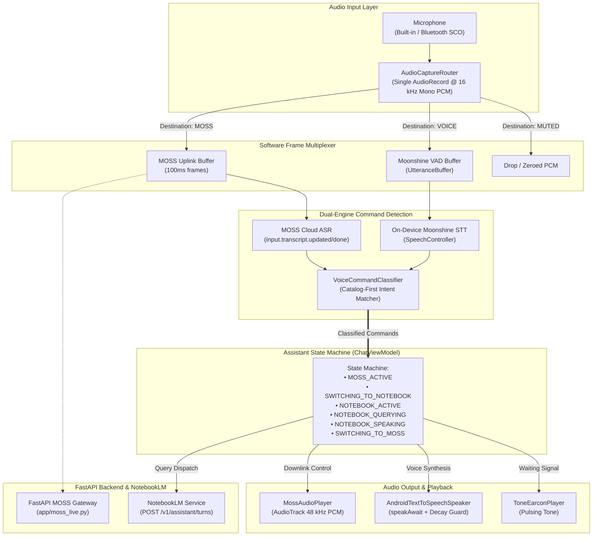
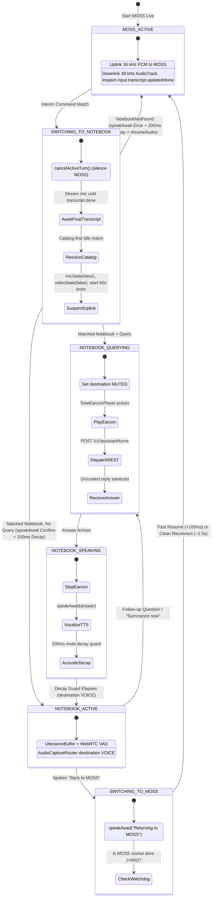

# Hands-Free Voice-Command Switching Between MOSS Live and NotebookLM

| Metadata | Details |
| :--- | :--- |
| **Author** | bull213 |
| **Status** | Approved / Remediated |
| **Date** | 2026-11-13 |
| **Reviewers** | `egm-zoom-out`, `egm-comprehension`, `egm-design`, `egm-structural`, `egm-style`, `egm-implementation-readiness`, `egm-codebase-details` |

---

## Overview

This feature establishes hands-free, voice-activated modal switching between **MOSS Live (full-duplex conversational voice)** and **Google NotebookLM Collections (grounded turn-based retrieval)** on Android. It replaces manual screen touch interactions with natural spoken voice commands, enabling users wearing earphones to transition deterministically between free-form real-time visual conversation with MOSS and grounded document question-answering with personal NotebookLM collections.

### Terminology & Glossary

*   **AudioFlinger**: Android's primary native audio server responsible for routing, mixing, and enforcing system-wide policy across hardware audio capture and playback streams.
*   **AudioRecord**: The native Android Java/Kotlin API responsible for reading uncompressed PCM audio buffers from the device's hardware microphones.
*   **VOICE_COMMUNICATION**: A specialized Android `MediaRecorder.AudioSource` preset that activates device-level hardware Acoustic Echo Cancellation (AEC), automatic gain control, and noise suppression.
*   **Bluetooth SCO (Synchronous Connection-Oriented)**: A bidirectional Bluetooth link providing 16 kHz mono microphone capture and voice playback for wireless headsets and earbuds.
*   **Moonshine ONNX**: An on-device automatic speech recognition (ASR) neural network executed locally via ONNX Runtime Mobile for offline voice transcription.
*   **WebRTC VAD (Voice Activity Detector)**: An on-device algorithmic audio classifier that segments continuous PCM frames into discrete speech utterances and silence blocks.
*   **Quiescent State**: A temporary power-efficient suspension state in which MOSS Live audio/video transmission is paused (`mic_state: false`) while keeping the underlying WebSocket connection open.
*   **Duplex Uplink**: Continuous 16 kHz mono PCM streaming from the Android microphone across the WebSocket connection to the upstream MOSS realtime voice server.

---

## The Problem

Users relying on earphones and visual accessibility face three critical physical and architectural constraints when consulting personal knowledge collections during an active voice session:

1.  **Upstream Duplex Contradiction**: Physical telemetry demonstrated that MOSS Live (upstream speech-to-speech at `wss://api.mosi.cn/v1/realtime`) ignores dynamically appended text instructions (`session.instructions.append`) while an active duplex audio stream is running. The cloud model fails to vocalize text answers arriving from external cloud RAG queries into the live stream, causing silent dropped responses.
2.  **Tactile Screen Dependency**: Navigating between MOSS Live and a NotebookLM collection currently requires manual physical interaction—opening a sidebar, browsing collections, tapping buttons, and manually initiating speech. For users interacting primarily through earphones or requiring accessibility support, this breaks hands-free continuity.
3.  **Hardware Audio Contention**: Android's `AudioFlinger` enforces strict restrictions on simultaneous `AudioRecord` sessions. Attempting to run real-time PCM streaming for MOSS while simultaneously running on-device Moonshine voice activity detection results in client muting (`isClientSilenced = true`), dropped speech buffers, or initialization failures on Android 12+ (API 31+).

To solve this, the application must execute a clean, deterministic **modal switch**:
- Maintain MOSS Live as the default full-duplex conversational assistant.
- Recognize spoken navigation commands (`"Use notebook [Name]"`, `"Back to MOSS"`, `"Summarize now"`).
- Temporarily suspend MOSS Live audio transmission without tearing down the connection prematurely.
- Route microphone speech into on-device Moonshine STT for grounded turn-based collection interactions.
- Provide acoustic confirmation cues and read grounded answers aloud via Android TTS.

---

## Goals

*   **Hands-Free Switching**: Switch between MOSS Live and any accessible NotebookLM collection via natural voice commands without touching the phone screen.
*   **Compound Single-Breath Querying**: Support compound commands combining notebook selection and query in a single breath (e.g., *"Use notebook Neuroscience, what is the dopamine pathway?"*), delivering the grounded answer in a single flow via cloud ASR gating.
*   **Two-Stage Fallback**: If the question portion is omitted or ambiguous (e.g., *"Use notebook Neuroscience"*), confirm the switch aloud (*"Switched to notebook Neuroscience."*) and open the microphone for the follow-up question.
*   **Low-Latency Resumption**: Maintain a 60-second quiescent suspension window for MOSS Live (`mic_state: false`), allowing instant resumption (<100ms) upon saying `"Back to MOSS"`, while closing the socket cleanly after 60 seconds to prevent billing and idle leaks.
*   **Hardware Audio Safety**: Multiplex all voice input through a single `AudioRecord` capture router, preventing hardware contention and client silencing bugs.
*   **Acoustic Echo Elimination**: Enforce a verified 200ms mute decay guard after TTS playback (100ms for Bluetooth headsets) to prevent the microphone from recording and transcribing the phone's own audio output.
*   **Clean Command Hygiene**: Ensure navigation commands (`"Use notebook X"`, `"Back to MOSS"`) are transient directives and never stored as user messages in the persistent chat database or forwarded as prompts to AI models.

---

## Non-Goals

*   **Simultaneous Dual Duplex**: We are not attempting to mix MOSS Live voice streaming and NotebookLM into an active three-way voice conference; the interaction is strictly modal.
*   **Continuous Background Moonshine**: We will not run Moonshine ONNX model streaming concurrently during MOSS Live duplex, which would waste device CPU and cause thermal throttling.
*   **Local Room DB Storage for Collections**: We do not store NotebookLM collection turns in the local Room database ([`conversations.db`](file:///c:/Users/liorc/PycharmProjects/PythonProject1/android/app/src/main/java/com/visualassistant/app/data/local/ConversationDatabase.kt)); collection history is managed upstream in Google NotebookLM and loaded into in-memory session state.
*   **Secondary Cloud Speech-to-Text Services**: We will not introduce external commercial STT services for command recognition; all detection relies on existing MOSS cloud transcripts and bundled on-device Moonshine.

---

## Critical User Journeys (CUJs)

### CUJ 1: Hands-Free Switch to Notebook with Compound Query
*   **Given**: User is engaged in an active MOSS Live duplex voice session.
*   **When**: User speaks: *"Use notebook Neuroscience, what is the dopamine pathway?"*
*   **Then**:
    1. MOSS cloud transcript delivers interim updates; detecting the command prefix triggers `response.cancel` to silence MOSS audio downlink while the microphone uplink remains active.
    2. Upon `input.transcript.done`, the classifier resolves `SWITCH_NOTEBOOK(notebook="Neuroscience", query="what is the dopamine pathway?")`.
    3. The client dispatches the query to `POST /v1/assistant/turns`, sets the audio capture destination to `AudioDestination.MUTED`, and suspends MOSS.
    4. A waiting earcon pulses while the coprocessor answers.
    5. The grounded answer is spoken aloud via Android TTS, prefixed with *"In Neuroscience:"*.
    6. Upon speech completion and a 200ms decay guard, the mic opens for follow-up collection questions.

### CUJ 2: Simple Switch with Two-Stage Fallback
*   **Given**: User is in an active MOSS Live voice session.
*   **When**: User speaks: *"Use notebook Car Maintenance"* without asking a question.
*   **Then**:
    1. Classifier identifies `SWITCH_NOTEBOOK(notebook="Car Maintenance", query=null)`.
    2. MOSS audio is suspended; Android TTS vocalizes: *"Switched to notebook Car Maintenance."*
    3. The state transitions to `NOTEBOOK_ACTIVE`, and on-device Moonshine begins listening for the user's first question after the 200ms decay guard.

### CUJ 3: Grounded Summarization ("Summarize now")
*   **Given**: User is interacting in a NotebookLM collection.
*   **When**: User speaks: *"Summarize now."*
*   **Then**:
    1. Moonshine transcribes the utterance; classifier detects `SUMMARIZE_NOW`.
    2. The client constructs a constrained 2-to-3 sentence summarization prompt and queries the backend.
    3. Waiting earcons pulse during retrieval, and the sanitized summary is read aloud via Android TTS.

### CUJ 4: Fast Resumption to MOSS Live ("Back to MOSS")
*   **Given**: User is in a NotebookLM collection, and less than 60 seconds have elapsed since MOSS was suspended.
*   **When**: User speaks: *"Back to MOSS."*
*   **Then**:
    1. Moonshine transcribes the command; classifier detects `BACK_TO_MOSS`.
    2. Android TTS speaks: *"Returning to MOSS."*
    3. Audio router points back to MOSS uplink, camera video is restored if previously active, MOSS `mic_state: true` is dispatched, and duplex conversation resumes in <100ms.

### CUJ 5: Auto-Reconnection after Quiescent Timeout
*   **Given**: User has been interacting in a NotebookLM collection for more than 60 seconds (MOSS socket closed by watchdog).
*   **When**: User speaks: *"Back to MOSS."*
*   **Then**:
    1. Classifier detects `BACK_TO_MOSS`.
    2. Android TTS speaks: *"Returning to MOSS."*
    3. Client executes a clean reconnection to `ws://127.0.0.1:8000/v1/realtime/moss-live` in the background, restoring live conversation within ~1.5s.

---

## Architecture & Technical Plan

### 1. High-Level System Architecture

The technical architecture coordinates four major functional layers across the Android client and the Python backend:



---

### 2. Core Architectural Components

#### Component 1: Unified Audio Capture Router (`AudioCaptureRouter.kt`)
*   **Location**: [`android/app/src/main/java/com/visualassistant/app/voice/AudioCaptureRouter.kt`](file:///c:/Users/liorc/PycharmProjects/PythonProject1/android/app/src/main/java/com/visualassistant/app/voice/AudioCaptureRouter.kt)
*   **Responsibility**: Owns the application's single `AudioRecord` instance.
*   **Audio Format**: 16,000 Hz, Mono, 16-bit Signed Linear PCM (`AudioFormat.ENCODING_PCM_16BIT`). Audio source is set to `MediaRecorder.AudioSource.VOICE_COMMUNICATION` with support for built-in microphones, Bluetooth SCO headsets, and wired USB devices.
*   **Adapter Delegation**: Exposes delegates to satisfy existing codebase interfaces without breaking contracts:
    - `asRealtimeAudioSource(): RealtimeAudioSource` for `MossLiveSessionController`.
    - `asAudioSource(): AudioSource` yielding `ReceiveChannel<AudioChunk>` for `SpeechController`.
*   **Lifecycle Reference Counting**: Internal atomic subscriber counter manages the physical `AudioRecord`. Recording starts on first subscriber `start()` and stops when all subscribers call `stop()`, or when `release()` is invoked in `MainActivity.onDestroy()`.
*   **Dedicated Thread Dispatch**: Operates a dedicated background coroutine pinned to `Dispatchers.IO` reading 1,600 samples (100ms / 3,200 bytes) per loop.
*   **Muted Buffer Semantics**:
    - When `AudioDestination.MUTED`: Completely drops frames for Moonshine (`onVoiceChunk`). For MOSS uplink, emits zeroed PCM frames if MOSS is in `SPEAKING` state (preserving uplink pacing for WebRTC AEC), or drops frames completely if MOSS is suspended.

#### Component 2: Spoken Intent & Catalog-First Classifier (`VoiceCommandClassifier.kt`)
*   **Location**: [`android/app/src/main/java/com/visualassistant/app/voice/VoiceCommandClassifier.kt`](file:///c:/Users/liorc/PycharmProjects/PythonProject1/android/app/src/main/java/com/visualassistant/app/voice/VoiceCommandClassifier.kt)
*   **Responsibility**: Pure Kotlin intent parser that transforms transcript strings into structured command representations:
    ```kotlin
    sealed interface SpokenCommand {
        data class SwitchNotebook(val notebook: NotebookItem, val query: String?) : SpokenCommand
        data class NotebookNotFound(val spokenTitle: String) : SpokenCommand
        object BackToMoss : SpokenCommand
        object SummarizeNow : SpokenCommand
        data class NormalSpeech(val text: String) : SpokenCommand
    }
    ```
*   **Catalog-First Longest Matching Algorithm**:
    1. Strip leading trigger prefixes: `^(?:use|switch to|open|check)\s+(?:notebook\s+)?` (case-insensitive).
    2. Sort `availableNotebooks` by `title.length` descending.
    3. Match candidate titles against the beginning of the post-prefix string.
    4. If a match is found:
       - Strip the matched title prefix and optional leading punctuation/delimiters (`^[\s,:\-\?]+`).
       - The entire remaining string is captured as the intact query, preserving interrogative pronouns (`what`, `how`, `why`, `explain`). If the remainder is blank, `query = null`.
    5. If no title matches: emit `SpokenCommand.NotebookNotFound(spokenTitle)`.
    6. Return Commands: `^(?:back to|switch to|return to|go back to)\s+moss\b.*$` (case-insensitive, accommodating trailing courtesy tokens like "please").
    7. Summarize Commands: `^(?:summarize now|summarize|give me a summary|summarize this notebook)\b.*$` (case-insensitive).

#### Component 3: MOSS Session Suspension & Watchdog Lifecycle
*   **Location**: [`android/app/src/main/java/com/visualassistant/app/mosslive/MossLiveSessionController.kt`](file:///c:/Users/liorc/PycharmProjects/PythonProject1/android/app/src/main/java/com/visualassistant/app/mosslive/MossLiveSessionController.kt)
*   **Lifecycle Extensions**:
    - `suspendAudio()`: Records `val wasCameraActive = mutableState.value.cameraSharing`. Dispatches `{"action": "mic_state", "enabled": false}` and `{"action": "video.state", "source": "camera", "enabled": false}` upstream. Pauses `MossAudioPlayer`.
    - `resumeAudio()`: Dispatches `{"action": "mic_state", "enabled": true}`. If `wasCameraActive` was true, dispatches `video.state(camera, true)` and signals `ChatViewModel` to re-arm `cameraStreamJob` (1,500ms JPEG heartbeat).
    - `resumeOrReconnect()`: If connection is open and suspended, resumes via `resumeAudio()` (<100ms). If the socket closed, launches a clean reconnection via `start()` (~1.5s).
*   **Interim Transcripts for Pre-emption**:
    - `MossLiveSessionController` emits both interim (`finalized = false`) and final (`finalized = true`) updates to `transcriptUpdates`.
    - On interim updates matching a command prefix, `ChatViewModel` calls `mossLive.cancelActiveTurn()` immediately to suppress MOSS speculative speech, while leaving the microphone uplink routed to MOSS until `input.transcript.done`.
*   **60-Second Quiescent Watchdog**:
    - `suspendAudio()` starts a 60-second coroutine timer.
    - If resumed before 60 seconds, watchdog cancels.
    - If timer expires, transport closes with `code=1000 ("quiescent_timeout")`, and controller transitions cleanly to `MossConnectionState.IDLE`.

#### Component 4: State Machine & Interaction Coordinator
*   **Location**: [`android/app/src/main/java/com/visualassistant/app/chat/ChatViewModel.kt`](file:///c:/Users/liorc/PycharmProjects/PythonProject1/android/app/src/main/java/com/visualassistant/app/chat/ChatViewModel.kt)
*   **State Model**:
    ```kotlin
    enum class AssistantMode {
        MOSS_ACTIVE,            // Normal MOSS Live duplex session
        SWITCHING_TO_NOTEBOOK,  // Preempting MOSS, finding notebook, vocalizing confirmation
        NOTEBOOK_ACTIVE,        // In collection; Moonshine STT listening
        NOTEBOOK_QUERYING,      // Query dispatched to backend; earcon pulsing
        NOTEBOOK_SPEAKING,      // TTS reading grounded answer aloud
        SWITCHING_TO_MOSS,      // Halting notebook mode, vocalizing return, resuming MOSS
    }
    ```
*   **Acoustic Decay & Suspension Bridges**:
    - Defines suspending extension `Speaker.speakAwait(text: String)` to bridge asynchronous TTS completion with coroutine sequencing.
    - Enforces a mandatory **200ms decay guard** for phone speaker playback (100ms for Bluetooth SCO) before opening the microphone to prevent self-transcription.
    - In `NOTEBOOK_ACTIVE`: Handles `NormalSpeech` by dispatching follow-up questions to `submitNotebookTurn`, and handles `SwitchNotebook` by switching collections directly.
    - In `submitNotebookTurn`: If `isVoice == true` and an error occurs, explicitly vocalizes the error message aloud via `speakAnswer()`.

---

### 3. Data Flow & Sequence Diagram



---

## Alternatives Considered

### Architectural Trade-Off Matrix

| Architectural Approach | Latency Profile | Battery & Thermal | Concurrency Safety | Implementation Complexity | Architectural Verdict |
| :--- | :--- | :--- | :--- | :--- | :--- |
| **1. Dynamic Instruction Injection into MOSS Duplex** | Low (<200ms) | Low | High | Low | **REJECTED**: Inoperable upstream; MOSS duplex ignores text instructions during active streaming. |
| **2. Dual Concurrent AudioRecord Instances** | Zero switch lag | Low | **Critical Failure** | Low | **REJECTED**: Violates Android audio policy; triggers `isClientSilenced = true` on Android 12+. |
| **3. Continuous Parallel Moonshine STT** | Ultra-low (local) | **Severe Battery Drain** (~35%/hr) | Medium | High | **REJECTED**: Excessive CPU, thermal throttling, and battery drain on mobile hardware. |
| **4. Immediate MOSS Socket Teardown (0s Window)** | High (1.5–3.0s reconnect) | Minimal | High | Low | **REJECTED**: Reconnect latency degrades conversational continuity during quick collection lookups. |
| **5. Indefinite MOSS Socket Suspension (No Watchdog)** | Instant (<100ms) | Leaks cloud quota | Low | Low | **REJECTED**: Upstream server terminates idle sockets after 2–5m; causes unhandled connection drops. |
| **Proposed: Modal Switching with 60s Quiescent Window** | **<100ms (<60s)**<br/>**~1.5s (>60s)** | **Optimized** (sleeps during suspension) | **High** (single `AudioRecord`) | **Moderate** | **ACCEPTED**: Balances instant resumption, battery efficiency, and hardware audio safety. |

---

## Security, Privacy & Safety

*   **Zero Credential Exposure**: Provider API keys (`MOSS_API_KEY`, Google cookies) reside exclusively on the Python backend ([`backend/.env`](file:///c:/Users/liorc/PycharmProjects/PythonProject1/backend/.env) and `backend/.data/notebooklm/`). Zero secrets or tokens are compiled into the Android APK.
*   **Content-Free Diagnostics**: Logging strictly excludes raw audio PCM buffers, user transcripts, and prompt bodies. Logs record only event names, state transitions, byte counters, and timing latencies.
*   **Transient Command Hygiene**: Spoken navigation commands (`"Use notebook X"`, `"Back to MOSS"`, `"Summarize now"`) are intercepted at the classifier stage and excluded from Room database persistence ([`conversations.db`](file:///c:/Users/liorc/PycharmProjects/PythonProject1/android/app/src/main/java/com/visualassistant/app/data/local/ConversationDatabase.kt)).
*   **Audio Hardware Safety**: Single-instance `AudioRecord` ownership guarantees that no zombie audio capture threads remain active when the application is backgrounded or destroyed.

---

## Non-Functional Requirements

### 1. Performance & Latency Budgets
*   **Pre-emption Latency**: Interim command prefix recognition to MOSS downlink cancellation (`response.cancel`) must complete within **< 150ms**.
*   **Switching from MOSS to Notebook**: ASR command recognition to query dispatch must complete within **< 400ms**.
*   **Resumption to MOSS (<60s)**: Audio re-engagement via `mic_state: true` must complete within **< 100ms**.
*   **Resumption to MOSS (>60s)**: Background reconnection and session launch must complete within **< 1.8s**.
*   **Acoustic Decay Guard**: Mandatory **200ms delay** for phone speakers (100ms for Bluetooth SCO headsets) between TTS completion and microphone reopening.

### 2. Stability & Error Handling
*   **Explicit Feedback on Missing Notebooks**: If a requested notebook is not found, the system announces *"Notebook [Name] not found. Staying in MOSS"* and resumes MOSS Live conversation.
*   **Spoken Accessibility Failures**: If NotebookLM credentials expire or an error occurs during turn retrieval, the error is read aloud via TTS (*"Google NotebookLM session expired. Please reconnect in Settings"*), ensuring hands-free accessibility.

---

## Detailed Implementation Plan

### Target Files to Create/Modify

#### 1. `android/app/src/main/java/com/visualassistant/app/voice/AudioCaptureRouter.kt` (Create)
*   **Type / Scope**: Android Audio Subsystem Component
*   **Rationale**: Owns the single physical `AudioRecord` instance (16 kHz mono PCM S16LE, `VOICE_COMMUNICATION` source) to eliminate hardware contention on Android 12+.
*   **Implementation Specification**:
    ```kotlin
    package com.visualassistant.app.voice

    import android.media.AudioRecord
    import com.visualassistant.app.mosslive.RealtimeAudioSource
    import kotlinx.coroutines.CoroutineScope
    import kotlinx.coroutines.channels.ReceiveChannel

    enum class AudioDestination { MOSS, VOICE, MUTED }

    interface AudioCaptureRouter {
        val activeDestination: AudioDestination
        fun setDestination(destination: AudioDestination)
        fun asRealtimeAudioSource(): RealtimeAudioSource
        fun asAudioSource(): AudioSource
        fun release()
    }
    ```
*   **Behavioral Rules**:
    - Operates a dedicated thread pinned to `Dispatchers.IO` reading blocking 1,600-sample chunks (100ms).
    - Internal atomic reference count: physical `AudioRecord.startRecording()` is called on first subscriber; `stop()` is called when subscriber count reaches 0.
    - When destination is `MOSS`: raw PCM byte chunks are passed to `RealtimeAudioSource.onPcm`.
    - When destination is `VOICE`: PCM chunks are converted to normalized floats and emitted as `AudioChunk` across `AudioSource.start()`.
    - When destination is `MUTED`: Drops frames for Moonshine; for MOSS, emits zeroed PCM frames if MOSS is `SPEAKING`, or drops frames if MOSS is suspended.
    - Quiescent Sleep: If idle in `NOTEBOOK_ACTIVE` for >30 seconds after MOSS socket closure, stops `AudioRecord` to turn off Android's green privacy indicator; re-arms on user touch or speech.

#### 2. `android/app/src/main/java/com/visualassistant/app/voice/VoiceCommandClassifier.kt` (Create)
*   **Type / Scope**: Android Pure Kotlin Logic Unit
*   **Rationale**: Parses speech transcripts into structured navigation intents with catalog-first title extraction.
*   **Implementation Specification**:
    ```kotlin
    package com.visualassistant.app.voice

    import com.visualassistant.app.data.NotebookItem

    sealed interface SpokenCommand {
        data class SwitchNotebook(val notebook: NotebookItem, val query: String?) : SpokenCommand
        data class NotebookNotFound(val spokenTitle: String) : SpokenCommand
        object BackToMoss : SpokenCommand
        object SummarizeNow : SpokenCommand
        data class NormalSpeech(val text: String) : SpokenCommand
    }

    object VoiceCommandClassifier {
        private val SWITCH_PREFIX = Regex("^(?:use|switch to|open|check)\\s+(?:notebook\\s+)?", RegexOption.IGNORE_CASE)
        private val BACK_TO_MOSS = Regex("^(?:back to|switch to|return to|go back to)\\s+moss\\b.*$", RegexOption.IGNORE_CASE)
        private val SUMMARIZE_NOW = Regex("^(?:summarize now|summarize|give me a summary|summarize this notebook)\\b.*$", RegexOption.IGNORE_CASE)

        fun hasCommandPrefix(transcript: String): Boolean {
            val trimmed = transcript.trim()
            return SWITCH_PREFIX.containsMatchIn(trimmed) || 
                   BACK_TO_MOSS.containsMatchIn(trimmed) || 
                   SUMMARIZE_NOW.containsMatchIn(trimmed)
        }

        fun classify(transcript: String, availableNotebooks: List<NotebookItem>): SpokenCommand {
            val text = transcript.trim()
            if (BACK_TO_MOSS.matches(text)) return SpokenCommand.BackToMoss
            if (SUMMARIZE_NOW.matches(text)) return SpokenCommand.SummarizeNow

            val prefixMatch = SWITCH_PREFIX.find(text)
            if (prefixMatch != null) {
                val remainder = text.substring(prefixMatch.range.last + 1).trim()
                // Sort notebooks by title length descending to match longest possible title first
                val sortedNotebooks = availableNotebooks.sortedByDescending { it.title.length }
                for (nb in sortedNotebooks) {
                    if (remainder.startsWith(nb.title, ignoreCase = true)) {
                        val postTitle = remainder.substring(nb.title.length).trimStart(' ', ',', ':', '-', '?')
                        val query = if (postTitle.isNotBlank()) postTitle else null
                        return SpokenCommand.SwitchNotebook(nb, query)
                    }
                }
                // Title not found in catalog
                val candidateTitle = remainder.split(Regex("[,:?\\s+and\\s+]"))[0].trim()
                return SpokenCommand.NotebookNotFound(candidateTitle.ifBlank { remainder })
            }

            return SpokenCommand.NormalSpeech(text)
        }
    }
    ```

#### 3. `android/app/src/main/java/com/visualassistant/app/mosslive/MossLiveSessionController.kt` (Modify)
*   **Type / Scope**: Android MOSS Live Client
*   **Implementation Changes**:
    - Update `updateInputTranscript`: Emit both interim (`finalized = false`) and final (`finalized = true`) updates to `mutableTranscriptUpdates`.
    - Add state property: `val isSuspended: Boolean get() = suspendedState.get()`.
    - Implement `suspendAudio()`:
      ```kotlin
      wasCameraActive = mutableState.value.cameraSharing
      dispatchedSuspension = true
      sendControl(MossLiveProtocol.micState(false))
      sendControl(MossLiveProtocol.videoState(source = "camera", enabled = false))
      mossAudioPlayer?.pause()
      startQuiescentWatchdog(60_000L)
      ```
    - Implement `resumeAudio()`:
      ```kotlin
      cancelQuiescentWatchdog()
      mossEchoSuppressor?.reset()
      sendControl(MossLiveProtocol.micState(true))
      if (wasCameraActive) {
          sendControl(MossLiveProtocol.videoState(source = "camera", enabled = true))
      }
      dispatchedSuspension = false
      ```
    - Implement `resumeOrReconnect(recentContext: List<ChatMessage>)`:
      ```kotlin
      if (isSuspended && transport.isOpen()) {
          resumeAudio()
      } else {
          start(sessionId = null, context = recentContext)
      }
      ```
    - 60-Second Watchdog: On timeout, calls `transport.close(1000, "quiescent_timeout")` and sets state to `MossConnectionState.IDLE`.

#### 4. `android/app/src/main/java/com/visualassistant/app/voice/SpeakerExtensions.kt` (Create)
*   **Type / Scope**: Android Voice Utility Extension
*   **Implementation Specification**:
    ```kotlin
    package com.visualassistant.app.voice

    import kotlinx.coroutines.suspendCancellableCoroutine
    import kotlin.coroutines.resume

    suspend fun Speaker.speakAwait(text: String, timeoutMillis: Long = 10_000L) = suspendCancellableCoroutine<Unit> { continuation ->
        speak(
            text = text,
            onStart = {},
            onDone = { if (continuation.isActive) continuation.resume(Unit) }
        )
        continuation.invokeOnCancellation {
            stop()
        }
    }
    ```

#### 5. `android/app/src/main/java/com/visualassistant/app/chat/ChatViewModel.kt` (Modify)
*   **Type / Scope**: Android Presentation & State Machine Coordinator
*   **Implementation Changes**:
    - In `init`: Observe `mossLive.transcriptUpdates`:
      - If `!update.finalized`: Check `VoiceCommandClassifier.hasCommandPrefix(update.text)`. If true, call `mossLive.cancelActiveTurn()` immediately to silence downlink.
      - If `update.finalized`: Pass `update.text` to `VoiceCommandClassifier.classify(update.text, state.value.notebooks)`.
    - Event Handling:
      - `is SpokenCommand.SwitchNotebook`:
        1. Call `mossLive.suspendAudio()`.
        2. Set `audioCaptureRouter.setDestination(AudioDestination.MUTED)`.
        3. Set `activeNotebook = command.notebook`.
        4. If `command.query != null`:
           - Transition to `AssistantMode.NOTEBOOK_QUERYING`.
           - Dispatch `submitNotebookTurn(command.notebook, command.query, isVoice = true)`.
        5. If `command.query == null`:
           - Transition to `AssistantMode.SWITCHING_TO_NOTEBOOK`.
           - Vocalize `speaker.speakAwait("Switched to notebook ${command.notebook.title}")`.
           - Execute 200ms decay guard: `delay(200)`.
           - Transition to `AssistantMode.NOTEBOOK_ACTIVE`.
           - Set `audioCaptureRouter.setDestination(AudioDestination.VOICE)`.
           - Start `speech?.start(viewModelScope, state.value.sessionId)`.
      - `is SpokenCommand.NotebookNotFound`:
        1. Vocalize `speaker.speakAwait("Notebook ${command.spokenTitle} not found. Staying in MOSS")`.
        2. Delay 200ms, then call `mossLive.resumeAudio()`.
      - `is SpokenCommand.BackToMoss`:
        1. Halt earcons and active speech: `speaker.stop(); earconPlayer?.stop()`.
        2. Set `activeNotebook = null`.
        3. Vocalize `speaker.speakAwait("Returning to MOSS")`.
        4. Delay 200ms.
        5. Set `audioCaptureRouter.setDestination(AudioDestination.MOSS)`.
        6. Call `mossLive.resumeOrReconnect(state.value.messages)`.
        7. If camera was active, re-arm `cameraStreamJob` (1,500ms JPEG heartbeat).
        8. Transition to `AssistantMode.MOSS_ACTIVE`.
      - `is SpokenCommand.SummarizeNow`:
        1. Prompt: *"In 2 to 3 concise spoken sentences, summarize the central takeaway and key conclusion of this notebook for hands-free audio listening."*
        2. Dispatch `submitNotebookTurn(activeNotebook, prompt, isVoice = true)`.
      - `is SpokenCommand.NormalSpeech`:
        - If in `AssistantMode.NOTEBOOK_ACTIVE` and `activeNotebook != null`:
          Dispatch `submitNotebookTurn(activeNotebook, command.text, isVoice = true)`.
    - Query Completion & Error Handling in `submitNotebookTurn`:
      - Inside `onDone` callback of `speakAnswer`:
        ```kotlin
        delay(200) // 200ms acoustic decay guard
        audioCaptureRouter.setDestination(AudioDestination.VOICE)
        speech?.start(viewModelScope, state.value.sessionId)
        ```
      - Inside `catch (error: Exception)`:
        If `isVoice == true`, invoke `speakAnswer(errorMessage, response.id)` so earphone users receive spoken audio feedback.

#### 6. `android/app/src/main/java/com/visualassistant/app/MainActivity.kt` (Modify)
*   **Type / Scope**: Activity Composition Root
*   **Implementation Changes**:
    - Instantiate single shared `AudioCaptureRouter`:
      `val audioRouter = PhoneAudioCaptureRouter(applicationContext)`
    - Inject `audioRouter.asRealtimeAudioSource()` into `MossLiveSessionController`.
    - Inject `audioRouter.asAudioSource()` into `SpeechController`.
    - In `onDestroy()`, call `audioRouter.release()`.

#### 7. `backend/app/moss_live.py` (Modify)
*   **Type / Scope**: FastAPI MOSS Live Gateway
*   **Implementation Changes**:
    - Upstream close synchronization: When Android client closes connection with `code=1000 ("quiescent_timeout")`, immediately close upstream WebSocket to `wss://api.mosi.cn/v1/realtime` with code 1000.
    - 15-Second Heartbeat Ping Task:
      - In `pump_android_to_provider`: When receiving `{"action": "mic_state", "enabled": false}`, start background ping task:
        ```python
        async def _ping_loop(upstream_ws):
            while True:
                await asyncio.sleep(15.0)
                if upstream_ws.open:
                    await upstream_ws.send(json.dumps({"action": "ping"}))
                    await upstream_ws.ping()
        ```
      - When receiving `{"action": "mic_state", "enabled": true}` or on socket disconnect, cancel the ping task cleanly.
    - Remove legacy prototype instruction injection routines (`_query_notebook_and_inject`, `session.instructions.append`).

#### 8. Concrete Unit and Integration Test Catalog

*   **`VoiceCommandClassifierTest.kt`** ([`android/app/src/test/java/com/visualassistant/app/voice/VoiceCommandClassifierTest.kt`](file:///c:/Users/liorc/PycharmProjects/PythonProject1/android/app/src/test/java/com/visualassistant/app/voice/VoiceCommandClassifierTest.kt)):
    - `testSingleCommandSwitchWithoutQuery()`: Asserts `"Use notebook Neuroscience"` resolves to `SwitchNotebook(Neuroscience, query = null)`.
    - `testCompoundQueryPreservesInterrogatives()`: Asserts `"Use notebook Neuroscience what is the dopamine pathway?"` preserves `"what is the dopamine pathway?"` intact as query.
    - `testMultiWordNotebookTitleWithAnd()`: Asserts `"Switch to notebook Car Maintenance and Repair"` resolves to notebook `"Car Maintenance and Repair"` without premature splitting.
    - `testUnknownNotebookEmitsNotebookNotFound()`: Asserts `"Use notebook Quantum Physics"` (not in catalog) returns `NotebookNotFound("Quantum Physics")`.
    - `testBackToMossWithCourtesyTokens()`: Asserts `"Back to MOSS please"` resolves to `BackToMoss`.
    - `testPlainConversationReturnsNormalSpeech()`: Asserts conversational speech is not classified as a command.

*   **`AudioCaptureRouterTest.kt`** ([`android/app/src/test/java/com/visualassistant/app/voice/AudioCaptureRouterTest.kt`](file:///c:/Users/liorc/PycharmProjects/PythonProject1/android/app/src/test/java/com/visualassistant/app/voice/AudioCaptureRouterTest.kt)):
    - `testDestinationSwitchingDirectsFrames()`: Verifies switching between `MOSS`, `VOICE`, and `MUTED` directs PCM buffers to the correct delegate.
    - `testMutedDestinationDropsVoiceFrames()`: Asserts zero frames are emitted to Moonshine channel when `MUTED`.
    - `testReferenceCountedLifecycle()`: Asserts physical recorder is stopped only when both `asRealtimeAudioSource()` and `asAudioSource()` have called `stop()`.

*   **`MossLiveSessionControllerTest.kt`** ([`android/app/src/test/java/com/visualassistant/app/mosslive/MossLiveSessionControllerTest.kt`](file:///c:/Users/liorc/PycharmProjects/PythonProject1/android/app/src/test/java/com/visualassistant/app/mosslive/MossLiveSessionControllerTest.kt)):
    - `testSuspendAudioDispatchesMicAndVideoStateFalse()`: Verifies correct JSON control actions sent upstream.
    - `testResumeAudioRestoresVideoStateIfPreviouslyActive()`: Verifies camera video re-enabled on resume.
    - `testWatchdogTimeoutClosesTransportAt60Seconds()`: Verifies clean socket close after 60,000ms.
    - `testInterimTranscriptEmitsToTranscriptUpdates()`: Asserts interim updates are dispatched for early pre-emption.

*   **`ChatViewModelSwitchingTest.kt`** ([`android/app/src/test/java/com/visualassistant/app/chat/ChatViewModelSwitchingTest.kt`](file:///c:/Users/liorc/PycharmProjects/PythonProject1/android/app/src/test/java/com/visualassistant/app/chat/ChatViewModelSwitchingTest.kt)):
    - `testCompoundQueryDispatchesTurnAndKeepsMutedUntilTTSDone()`: Verifies destination remains `MUTED` during query, earcon, and TTS.
    - `testDecayGuardEnforces200msDelayBeforeVoiceRouting()`: Verifies 200ms acoustic delay before Moonshine opens.
    - `testFollowUpSpeechInNotebookActiveDispatchesQuery()`: Asserts `NormalSpeech` in notebook mode routes to `submitNotebookTurn`.
    - `testFailureInVoiceModeSpeaksErrorAloud()`: Verifies TTS vocalization when `submitNotebookTurn` fails.

*   **`backend/tests/test_moss_live.py`** ([`backend/tests/test_moss_live.py`](file:///c:/Users/liorc/PycharmProjects/PythonProject1/backend/tests/test_moss_live.py)):
    - `test_gateway_forwards_quiescent_timeout_to_upstream()`: Asserts code 1000 close terminates upstream WebSocket.
    - `test_heartbeat_ping_loop_starts_on_mic_state_false()`: Asserts 15s ping task begins on suspension.

---

## Open Questions & Future Work

1.  **Bluetooth SCO Disconnection During Quiescent Suspension**: If a user disconnects their Bluetooth headset while MOSS Live is suspended, Android re-routes audio to built-in speaker/mic. When resuming, the decay guard must automatically switch from the 100ms headset budget to the 200ms built-in speaker budget.
2.  **Rapid Back-and-Forth Switching Limits**: Rapidly alternating commands (*"Use notebook X"* $\to$ *"Back to MOSS"* $\to$ *"Use notebook Y"* in <2 seconds) could trigger rate limits on MOSS WebSocket control frames. A debounce threshold of 500ms should be evaluated during hardware testing.
3.  **Local Dynamic Catalog Caching**: Currently, `availableNotebooks` is populated upon entering the screen. A background sync mechanism could pre-fetch notebook titles on app boot so switching commands work instantly even before visiting the notebook tab.

---

## Verification Plan

*   **Compilation & Build**:
    ```powershell
    .\android\gradlew.bat --no-daemon -p android assembleDebug testDebugUnitTest lintDebug
    ```
*   **Android JVM Unit Tests**:
    - Execute `VoiceCommandClassifierTest`, `AudioCaptureRouterTest`, `MossLiveSessionControllerTest`, and `ChatViewModelSwitchingTest`.
    - Assert 100% pass rate across all new and existing test suites (116+ existing JVM tests).
*   **Backend Verification**:
    ```powershell
    .\.venv\Scripts\python.exe -m pytest backend/tests/test_moss_live.py backend/tests/test_notebooklm_rag.py backend/tests/test_notebooklm_nlp.py -v
    ```
*   **Manual On-Device Smoke Test**:
    1. Connect Samsung S24+ via USB and launch with `.\Start MOSS Live.cmd`.
    2. Start MOSS Live and converse normally.
    3. Say: *"Use notebook Neuroscience, what is the dopamine pathway?"* $\to$ Verify immediate MOSS silence, waiting earcon, and TTS answer readout.
    4. Say: *"Summarize now"* $\to$ Verify grounded summary generation.
    5. Say: *"Back to MOSS"* $\to$ Verify *"Returning to MOSS"* announcement and sub-100ms resumption of live conversation.
    6. Repeat with >60s delay in notebook $\to$ Verify automatic background reconnection.

---

*Drafted with EGM*
