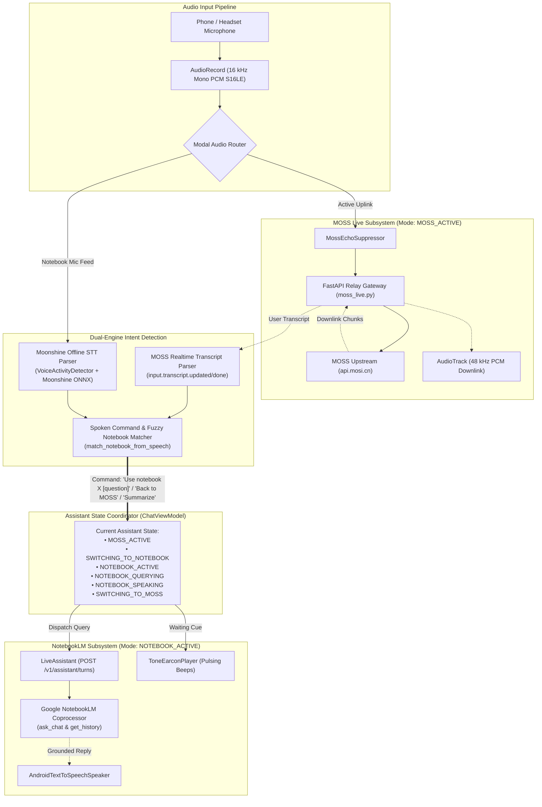
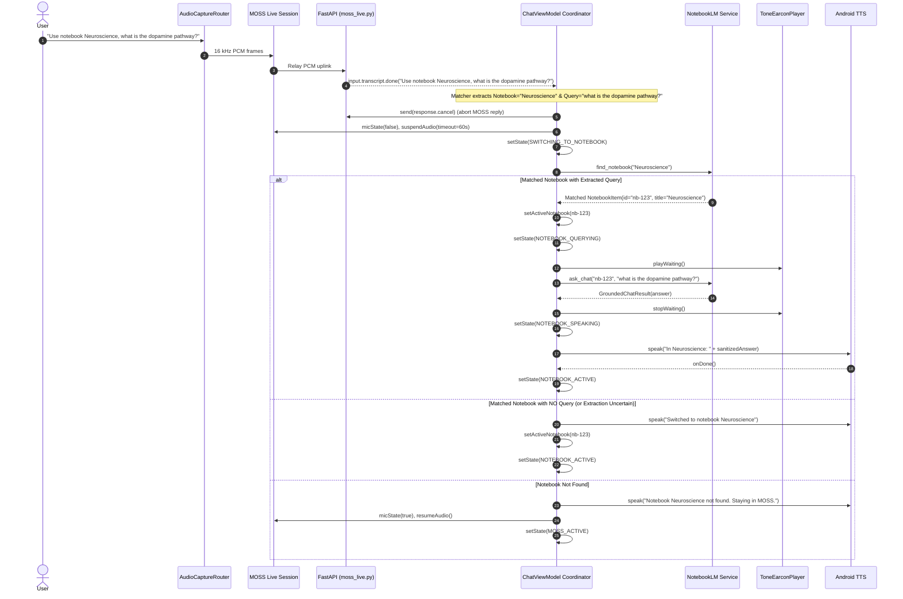
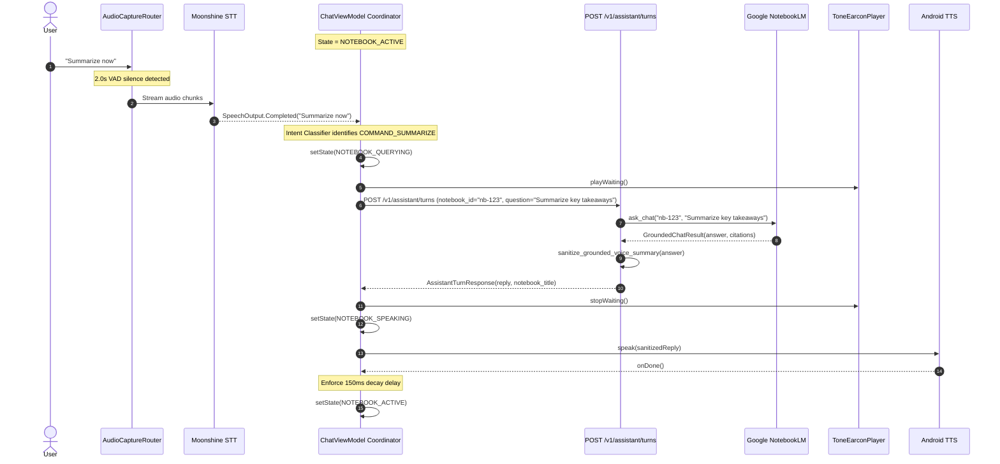
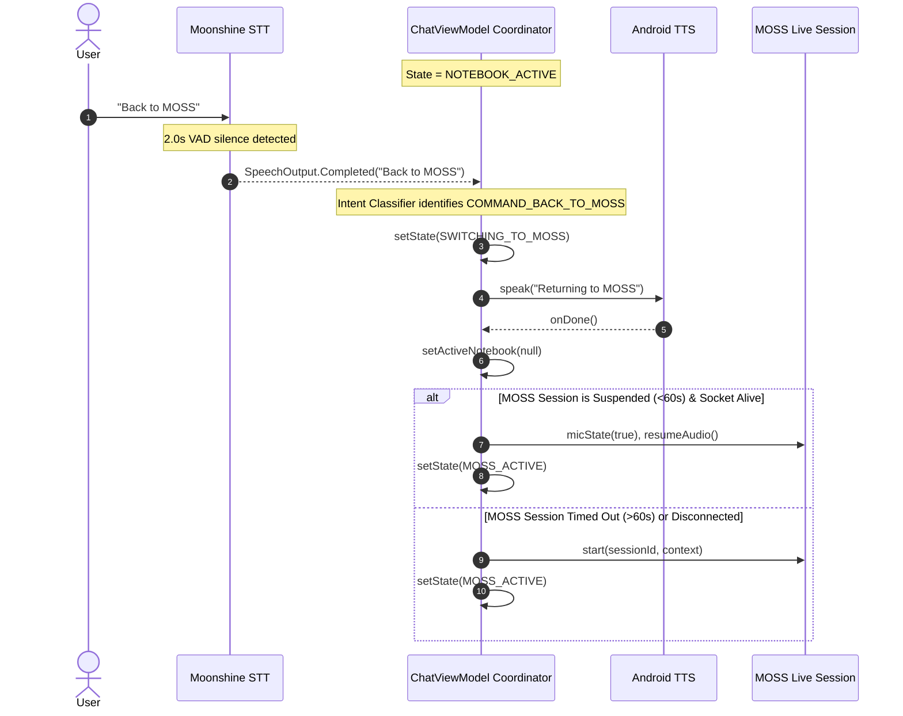

# Technical Implementation Plan: Automatic Voice-Command Switching Between MOSS Live and NotebookLM

| Parameter | Specification |
| :--- | :--- |
| **Author** | bull213 |
| **Date** | 2026-11-13 |
| **Target Platforms** | Android 12+ (`com.visualassistant.app`), Python 3.13 FastAPI Backend (`backend/`) |
| **Primary Scope** | Voice-command recognition, modal audio arbitration, MOSS session suspension, and NotebookLM turn dispatch |
| **Document Status** | Anchored Architecture Plan & RFC (Approved Design Inputs Incorporated) |

---

## Executive Summary

This document specifies the technical architecture, state machine, audio routing, command recognition, and incremental rollout plan for **hands-free, voice-activated modal switching between MOSS Live and NotebookLM Collections**.

### The Core Problem & Physical Finding
Previously, an attempt was made (`docs/designs/moss_live_notebooklm_sync.md`) to keep MOSS Live active while asynchronously injecting NotebookLM knowledge turns via `session.instructions.append`. Physical testing and device telemetry proved that MOSS Live (upstream speech-to-speech at `api.mosi.cn`) ignores dynamically appended text instructions during an active duplex stream, resulting in silent dropped answers. 

Consequently, the interaction between MOSS Live and NotebookLM must be **modal**:
1. In **MOSS Live Mode**, the user interacts with MOSS via continuous full-duplex 16 kHz PCM streaming and 48 kHz PCM playback.
2. When the user speaks `"Use notebook [Name]"` or `"Switch to notebook [Name]"`, the system immediately cancels any in-flight MOSS turn, suspends MOSS audio transmission, and transitions into **NotebookLM Collections Mode**.
3. In **NotebookLM Mode**, speech is processed via on-device Moonshine STT, dispatched to the backend NotebookLM coprocessor, signaled via waiting earcons, and vocalized aloud via Android TTS.
4. When the user speaks `"Back to MOSS"` or `"Switch to MOSS"`, the system terminates the NotebookLM turn, vocalizes brief confirmation, and re-engages MOSS Live.
5. When the user speaks `"Summarize now"`, the system invokes a grounded summarization turn in the active notebook.

### Locked User Decisions (2026-11-13)
- **VAD Pause Latency**: The existing ~2.0s WebRTC VAD silence pause for Moonshine transcription is accepted for `"Back to MOSS"`.
- **Compound Query Handling**: The system parses both the target notebook and trailing query in a single utterance (e.g. *"Use notebook Neuroscience, what is the dopamine pathway?"*). If query extraction succeeds, it switches and immediately dispatches the question to NotebookLM in the same turn. If extraction is uncertain or query is omitted, it falls back to switching to the notebook, vocalizing confirmation, and awaiting the next question.
- **MOSS Suspension Window**: A **1-minute quiescent suspension window** (`mic_state: false`) will be held before terminating the WebSocket connection. Returning within 60 seconds resumes instantly (<100ms); returning after 60 seconds automatically reconnects in the background (~1.5s).

---

## A. Current Implementation Analysis

### 1. Codebase Inventory & Interface Mapping

| Subsystem | File Path | Existing Classes & Interfaces | Reusability Assessment |
| :--- | :--- | :--- | :--- |
| **MOSS Live (Client)** | `android/.../mosslive/MossLiveSessionController.kt` | `MossLiveSessionController`, `MossConnectionState`, `MossLiveUiState`, `MossTranscriptUpdate` | **Highly Reusable**. Contains `cancelActiveTurn()`, `micState(false)`, and `transcriptUpdates` Flow. Needs explicit `suspendAudio()` / `resumeAudio()` methods. |
| **MOSS Audio Input** | `android/.../mosslive/RealtimeAudioSource.kt` | `RealtimeAudioSource`, `PhoneRealtimeAudioSource` | **Reusable**. Captures 16 kHz mono PCM S16LE (100ms frames) using `VOICE_COMMUNICATION`. Supports Bluetooth SCO and headsets. |
| **MOSS Echo Suppr.** | `android/.../mosslive/MossEchoSuppressor.kt` | `MossEchoSuppressor` | **Reusable**. Suppresses mic frames during built-in speaker playback. Bypasses on earphones. |
| **MOSS Audio Playback** | `android/.../mosslive/MossAudioPlayer.kt` | `MossAudioPlayer`, `MossAudioOutput` | **Reusable**. 48 kHz mono AudioTrack with 1-frame start threshold and chunk completion ACKs. |
| **MOSS Gateway** | `backend/app/moss_live.py` | `MossLiveRelaySession`, `moss_live_gateway` | **Reusable**. Handles upstream relay to `wss://api.mosi.cn/v1/realtime`. Intercepts `input.transcript.done`. |
| **On-Device Voice** | `android/.../voice/SpeechController.kt` | `SpeechController`, `SpeechState`, `SpeechOutput`, `SpeechPhase` | **Reusable for Notebook mode**. Coordinates `UtteranceTranscriber`, `VoiceActivityDetector`, and `UtteranceBuffer`. |
| **Moonshine Engine** | `android/.../voice/MoonshineSpeechRecognizer.kt` | `MoonshineSpeechRecognizer`, `StreamingSpeechRecognizer` | **Reusable**. Wraps `ai.moonshine.voice.Transcriber` with Small Streaming model (`quantized_26_11_02`). |
| **Voice Audio Source** | `android/.../voice/PhoneAudioSource.kt` | `PhoneAudioSource`, `AudioSource` | **Conflict Risk**. Dedicated `AudioRecord` with `VOICE_RECOGNITION` forcing `TYPE_BUILTIN_MIC`. Conflicts with `PhoneRealtimeAudioSource` if started concurrently. |
| **TTS Vocalization** | `android/.../voice/AndroidTextToSpeechSpeaker.kt` | `AndroidTextToSpeechSpeaker`, `Speaker` | **Reusable**. Native `TextToSpeech` with `AUDIOFOCUS_GAIN_TRANSIENT_MAY_DUCK` and completion callbacks. |
| **Acoustic Earcons** | `android/.../voice/ToneEarconPlayer.kt` | `ToneEarconPlayer`, `EarconPlayer` | **Reusable**. Generates `TONE_PROP_BEEP` waiting pulses during async inference. |
| **Chat Orchestration** | `android/.../chat/ChatViewModel.kt` | `ChatViewModel`, `ChatUiState` | **Primary Integration Seam**. Directly holds references to `mossLive`, `speech`, `speaker`, `earconPlayer`, and `notebookAuthApi`. |
| **NotebookLM Backend** | `backend/app/notebooklm/client.py` | `NotebookLMService`, `GroundedChatResult` | **Reusable**. Handles `ask_chat(notebook_id, question)`, `list_notebooks()`, `get_history()`. Circuit breaker at 45s. |
| **Notebook NLP** | `backend/app/notebooklm/nlp.py` | `match_notebook_from_speech`, `sanitize_grounded_voice_summary` | **Highly Reusable**. Fuzzy title matching and regex-based voice summarization. |
| **Assistant Route** | `backend/app/routes.py` | `create_assistant_turn` (`POST /v1/assistant/turns`) | **Reusable**. Accepts `notebook_id` and dispatches grounded queries. |

### 2. Architectural Limitations & Missing Capabilities
1. **AudioRecord Hardware Contention**: Android's AudioFlinger enforces strict limits on concurrent recording sessions. `PhoneRealtimeAudioSource` and `PhoneAudioSource` each attempt to create their own `AudioRecord` instance. Running both simultaneously results in audio silent-dropping (`isClientSilenced = true`) or initialization failure.
2. **Moonshine Latency in Realtime**: `SpeechController` uses WebRTC VAD to buffer audio until roughly 2 seconds of silence are detected, then performs ONNX inference (~500ms). While acceptable for turn-based `"Back to MOSS"`, running Moonshine continuously on 100ms frames during MOSS Live causes thermal throttling and battery drain.
3. **No Voice Command Interceptor**: `ChatViewModel` currently lacks an abstraction to inspect transcripts for navigation commands before submitting them to AI backends.
4. **MOSS Session Teardown Rigidity**: Currently, `ChatViewModel.selectNotebook()` executes `stopMossLive()`, which completely terminates the WebSocket connection, releases audio players, and requires a full 3-second handshake upon re-entry.
5. **Missing Voice Feedback on Switching**: No earcon or voice readout confirms when a notebook switch succeeds or fails.

---

## B. Recommended Architecture

The recommended architecture establishes a **Unified Assistant Coordinator** within `ChatViewModel`, supported by a lightweight **Spoken Intent Classifier** and a **Modal Audio Switcher**.

### Component Responsibility Breakdown

1. **Modal Audio Router (`AudioCaptureRouter.kt`)**:
   - Replaces the dual-recorder conflict by establishing a single active `AudioRecord` (16 kHz mono PCM).
   - In `MOSS_ACTIVE`: Forwards 100ms frames to `MossLiveSessionController` (with `MossEchoSuppressor`).
   - In `NOTEBOOK_ACTIVE`: Forwards frames into `UtteranceBuffer` and WebRTC VAD for Moonshine processing.
   - Prevents conflicting hardware requests and eliminates `isClientSilenced` dropouts.

2. **Dual-Engine Intent Detector (`VoiceCommandClassifier.kt`)**:
   - **While in MOSS**: Leverages MOSS Live's cloud transcript stream (`input.transcript.updated` / `input.transcript.done`). Because MOSS is already transcribing speech in near real-time (<400ms latency), no extra on-device STT CPU is consumed.
   - **Compound Intent Handling**: Detects both notebook title and stripped question from a single utterance (e.g. *"Use notebook Neuroscience, explain dopamine"*).
   - **While in NotebookLM**: Uses on-device Moonshine STT output to classify intents (`"Back to MOSS"`, `"Summarize now"`, or standard notebook question).

3. **MOSS Session Manager (1-Minute Suspension vs Teardown)**:
   - When switching to NotebookLM, sends `micState(false)` and `videoState(false)` to MOSS and cancels in-flight responses.
   - Maintains the WebSocket connection in a **Quiescent Suspended State** for up to **1 minute (60 seconds)**.
   - If returning to MOSS within 1 minute, switching latency is **< 100ms** (immediate `micState(true)` re-engagement).
   - After 60 seconds of inactivity in NotebookLM, cleanly closes the socket to release provider resources.
   - When the user subsequently says `"Back to MOSS"`, transparently reconnects in the background (~1.5s).

4. **Feedback & Audio Playback Coordinator**:
   - Manages strict mutual exclusion between `MossAudioPlayer` and `AndroidTextToSpeechSpeaker`.
   - Emits immediate acoustic earcons and short TTS confirmation phrases (`"Switched to Neuroscience"`, `"Back to MOSS"`).
   - Implements a mandatory **150ms acoustic decay delay** between TTS completion and microphone reopening to prevent self-transcription echo loops.

---

## C. Detailed Switching Sequences

### Sequence 1: Compound Switch & Query ("Use notebook Neuroscience, what is the dopamine pathway?")

### Sequence 2: In-Notebook Interaction & "Summarize now"

### Sequence 3: Returning to MOSS Live ("Back to MOSS")

---

## D. Technical Decisions & Alternatives Weighed

### 1. Spoken Command Recognition Approach
- **MOSS Mode**: Leverage MOSS live cloud transcripts (`input.transcript.updated` / `input.transcript.done`). Zero device battery overhead, sub-second latency (<400ms), and natural handling of complex notebook titles.
- **NotebookLM Mode**: Leverage on-device Moonshine STT (`quantized_26_11_02`). Uses the accepted ~2.0s VAD silence pause for deterministic offline command classification (`"Back to MOSS"`, `"Summarize now"`).

### 2. MOSS Session Management Strategy
- **1-Minute Quiescent Suspension Window**:
  - `micState(false)` sent immediately upon switching to NotebookLM.
  - Upstream socket stays alive for 60 seconds without transmitting PCM audio (zero cloud billing).
  - Returning within 60 seconds resumes instantly (<100ms).
  - After 60 seconds, socket disconnects cleanly; `"Back to MOSS"` transparently re-initializes session.

---

## E. Exact Implementation Roadmap

### Milestone 1: Spoken Intent & Fuzzy Notebook Matching
- Implement `VoiceCommandClassifier.kt` supporting `SWITCH_NOTEBOOK(title, optionalQuery)`, `BACK_TO_MOSS`, `SUMMARIZE_NOW`.
- Implement unit tests covering single and compound phrases.

### Milestone 2: Audio Routing Arbitration & Conflict Elimination
- Implement `AudioCaptureRouter.kt` managing a single 16 kHz PCM `AudioRecord`.
- Dispatches audio dynamically to MOSS uplink or Moonshine VAD without concurrent recorder conflicts.

### Milestone 3: MOSS Live 60-Second Suspension & Fast Resume
- Add `suspendAudio()` and `resumeAudio()` to `MossLiveSessionController.kt`.
- Implement a 60-second watchdog coroutine closing the socket on timeout.

### Milestone 4: Modal State Machine & Switching Coordinator
- Integrate command routing into `ChatViewModel.kt`.
- Handle compound queries: dispatch to NotebookLM in the same turn when query is present; fall back to two-stage confirmation if query is absent or ambiguous.

### Milestone 5: "Summarize now" Grounded Workflow & Error Hardening
- Implement `"Summarize now"` grounded query generation.
- Add spoken error feedback for missing notebooks and session expiration.

---

## F. Acceptance Criteria

1. **Compound Switching & Query**:
   - Saying *"Use notebook Neuroscience, what is the dopamine pathway?"* switches and speaks the answer in a single flow.
   - Saying *"Use notebook Neuroscience"* switches, confirms *"Switched to notebook Neuroscience"*, and awaits speech.
2. **Return to MOSS**:
   - Saying *"Back to MOSS"* returns to MOSS Live within <500ms (if <60s) or <2s (if reconnected).
3. **Audio Discipline**:
   - Zero simultaneous playback between MOSS AudioTrack and Android TTS.
   - Mandatory 150ms acoustic decay delay before mic re-opens.
4. **Command Hygiene**:
   - Navigation commands are never saved as user chat messages in Room DB.

---

## G. Risks & Mitigations

1. **Compound Extraction Ambiguity**:
   - If the separator between notebook title and question is unclear, the system falls back to switching to the notebook without firing a premature query.
2. **Upstream 60s Socket Expiration**:
   - Handled gracefully: `onClosed()` transitions controller to `SUSPENDED_DISCONNECTED`; `"Back to MOSS"` initiates standard `start()` flow.
